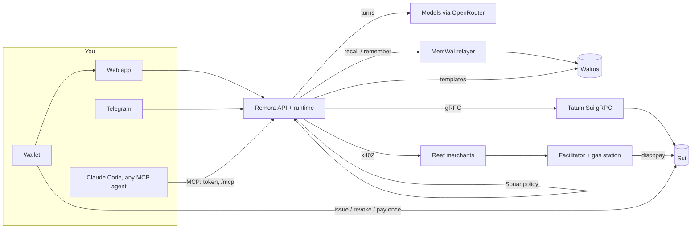
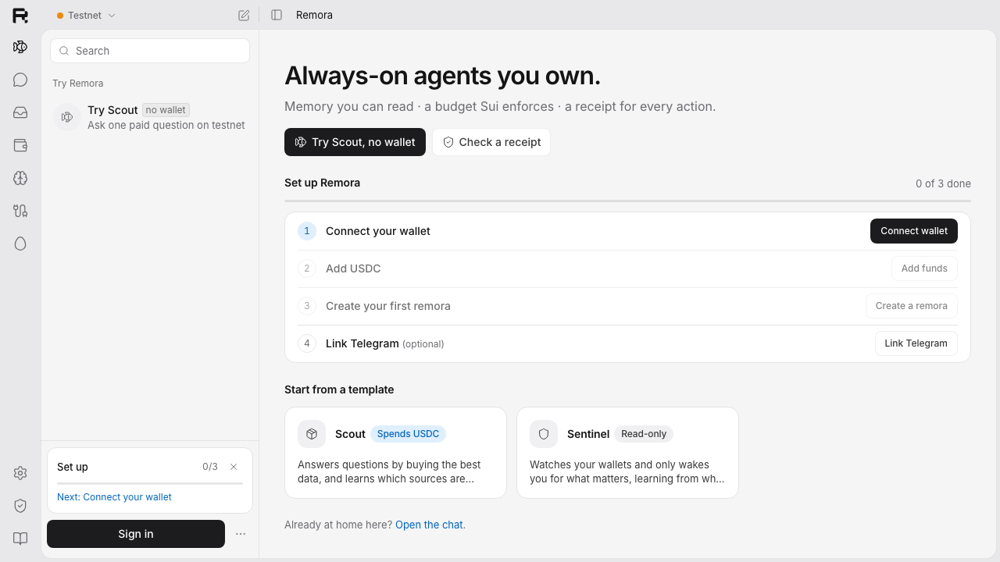
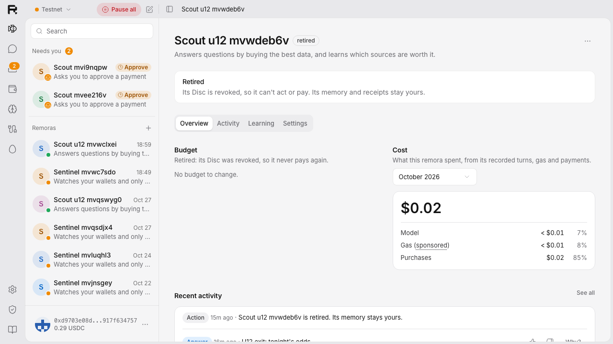
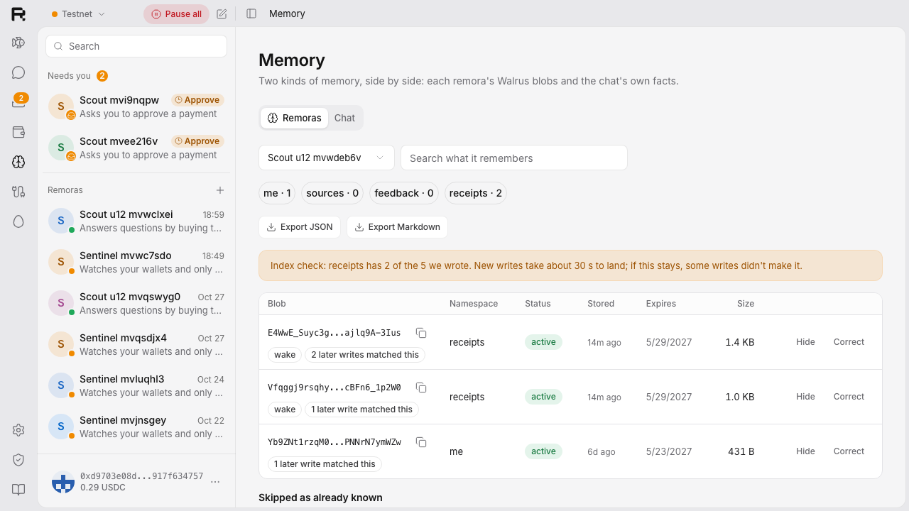
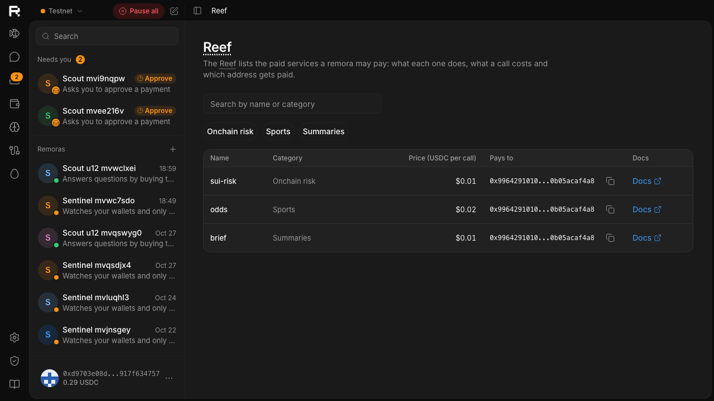

# Remora

**Always-on agents you actually own.**

A *remora* is an AI agent that runs errands for you: it watches your wallet, answers questions, and buys
the data it needs. Every remora has three things most agents don't:
- **A budget Sui enforces, not the prompt.** The **Disc** is built on Sui's native app-bound
  allowances. It pays for data over **x402**, settled on Sui by our own facilitator. Not even Remora's
  server can spend past it.
- **A memory you can read, on Walrus.** It learns from your 👍 and 👎. You can inspect it, correct
  it, export it, and take it to Claude Code.
- **A receipt for every decision.** Each receipt is a **Wake**. Payment intents are anchored onchain,
  and every server-side Sui call goes through **Tatum's gRPC**.

> *It goes wherever you go. It cleans up after you. It never takes the wheel.*

## For judges
| | |
|---|---|
| **Entry** | *Total Recall*, **Track 2: Smart Agents for Real Life**. Also **Best Walrus Memory** and **Best Use of Agent Payments** (x402 on Sui, [ADR-0084](docs/adr/0084-enter-best-use-of-agent-payments.md)) |
| **Watch** | The demo video: **[video URL]** (2:45, [script](docs/remora-plan.md#demo-script-245)) |
| **Try** | **[app URL]**`/playground`: a Scout with a $1 Disc, no wallet needed |
| **Read** | The blog post, **[blog URL]** ([draft](docs/launch/blog-draft.md)), then [the docs](docs/README.md) |
| **Walrus Memory on mainnet** | **360 memories** on Oct 31 (`bun run diagnose:memory` reads the account) |
| **Tatum** | Every server-side Sui call goes over Tatum's gRPC: the 12 calls listed [below](#how-remora-uses-tatum), generated from the code. The Data API prices gas |
| **Honest about** | [What's real, what isn't](#whats-real-what-isnt), and the [work done before the window](#built-on-prior-work) |

## In one minute
1. **An unknown token lands in your wallet.**
   - Your Sentinel pings you and asks your Scout.
   - Scout pays 0.01 USDC from its Disc for a `sui-risk` report on the token's package, then answers.
   - The receipt checks out onchain.
2. **You mark a dust ping 👎.**
   - Sentinel writes a rule to Walrus Memory and stays quiet the next time.
   - That decision's receipt cites the rule's blob.
3. **A paid answer says "pay this address".**
   - Sonar blocks it.
   - Forced past Sonar, the Disc aborts it onchain.
   - In CI: 28 attacks, 0 overspends.
4. **If the remora's key ever pays without a decision,** you're told within minutes. You rotate the key
   with one signature.

## Try it
- **No wallet:** open `/playground`. You get your own Scout with a **$1 Disc** for a few questions
  ([ADR-0051](docs/adr/0051-playground.md)).
  - The worst case is $1, enforced onchain.
  - The Disc is revoked when the session ends.
- **With a wallet:** sign in, then do one of these:
  - create a **Scout**, which buys data to answer you;
  - create a **Sentinel**, which watches your addresses and learns what matters;
  - hatch a remora from the **Hatchery**.

## How it learns
The learning loop: **your signal → a memory on Walrus → a different decision → a receipt that cites
that memory.**

- **Sentinel learns rules from you.** A 👎 on a ping becomes a rule in Walrus Memory. The next event of
  that kind is ignored, and the Wake for that quiet decision cites the rule's blob.
  - The Proof view shows both decisions and the one blob that changed between them.
  - Recorded on testnet: the rule landed on Walrus in 25.3 s
    ([U7 exit §5](docs/spikes/2026-10-22-u7-exit.md)).
- **Scout learns which sources are worth paying for.** A 👍 or 👎 on an answer scores the data sources
  it bought.
  - Each source keeps a track record, like *"10 calls · 2 useful · 8 noise · $0.050 per useful
    answer"*.
  - A newer score replaces the old one.
- **Memory knows what still holds** ([ADR-0074](docs/adr/0074-memory-facts-and-admission.md), after the
  [Dewee write-up](https://zuey.me/articles/dewee-memory-khi-ai-khong-chi-biet-nho?lang=vi)).
  - Each memory's facts go into a ledger next to Walrus Memory: when each fact holds, who said it,
    and which blobs it rests on.
  - Before the model reads its recall, admission drops what no longer holds and what repeats. It adds
    one line of what's true now.
  - Your word beats an agent's guess, and your own memories rank first
    ([ADR-0086](docs/adr/0086-owner-memory-first-and-visible-duplicates.md)).
- **Nothing is dropped silently.** A write skipped as a duplicate shows in the memory inspector, next
  to the memory it matched.
- **It's your memory.**
  - You can hide, correct or forget a memory, and export to Markdown or JSON.
  - Claude Code reads the same memories through Remora's MCP server.
- **Charts** come only from recorded events: Sentinel's noise rate, and Scout's cost per useful answer
  (`GET /api/learning/export`).

## Agent payments: x402, settled on Sui
- **The x402 flow.** Scout asks a Reef service, gets `402 Payment Required`, pays from its Disc, and
  gets the answer.
- **Our own `exact` facilitator for Sui** ([apps/facilitator](apps/facilitator/README.md)).
  - **Before it settles, it checks:**
    - the signature;
    - a simulation through Tatum;
    - that the payee and the amount match the request;
    - for Reef services, that the payment is a Disc `pay` with a matching `Paid` event.
  - **Then it settles:** it sponsors the gas and executes.
- **The remora's key holds 0 SUI.** All it can do is spend from its Disc, inside the caps, to the
  payees on its list.
- **Agents over MCP pay the same way.** Claude Code, with a scoped token, pays through the remora's
  Disc. Over the cap, it asks you first.
- **Red team.** `bun run evals` runs 28 attacks in CI, with 0 overspends
  ([evals/](evals/README.md)). Under them, the Move tests prove that money reaches only allowlisted
  payees, within the caps.

## What it does, with proof

| | What you see | Proof (testnet) | Built |
|---|---|---|---|
| **Disc** | One signature gives a remora a budget: a monthly limit, a per-payment cap, Reef payees, and expiry. Revoke, rotate or pause from your wallet | [Disc spike](docs/spikes/2026-10-19-disc-testnet.md); [Move security](packages/move/SECURITY.md) | Oct 19, before the window |
| **Scout** | Buys `sui-risk`, `odds` or `brief` data over x402 when it helps, answers, and says what it cost | [W2 exit](docs/spikes/2026-10-19-w2-exit.md): first remora in 4.4 s, a paid answer in 13 s | Oct 19, before the window |
| **Sentinel** | Watches addresses through Tatum's checkpoint stream; you teach it rules in plain words or with 👎 | [W2 exit §4](docs/spikes/2026-10-19-w2-exit.md) | Oct 19, before the window; rules from 👎 on Oct 22 |
| **Injection** | A paid answer says "pay <evil URL>" and the model obeys: Sonar blocks it; forced past Sonar, **the Disc aborts it onchain** | `7NYf3QGEX8UEbU7nBhv1egC6tZFoUq23NWZZSjoLnpSV` (`EPayeeNotAllowed`) | Oct 19, before the window |
| **Chat, rooms, teams** | Chat 1-1 with each remora, rooms with routing, a model per remora, a whole team from one Markdown file with one signature | [U6 exit](docs/spikes/2026-10-21-u6-exit.md) | Oct 21 |
| **Hatchery** | Share a remora as a Walrus blob with its author onchain; anyone hatches a copy through a consent screen with one signature | [U7 exit](docs/spikes/2026-10-22-u7-exit.md): hatch `DTq4sd4z…`, a poisoned template refused | Oct 21–22 |
| **Proof of Learning** | A ping, 👎, a rule, then silence on the same kind of event, with the rule's memory blob as the delta | [U7 exit §5](docs/spikes/2026-10-22-u7-exit.md) | Oct 22 |
| **Your memory** | Hide, correct, forget all, expiry, Markdown/JSON export, and Claude Code via `packages/mcp` | [U7 exit §6](docs/spikes/2026-10-22-u7-exit.md) | Oct 22 |
| **Agents (MCP)** | Make a scoped, revocable token on the Connections page and Claude Code (or any MCP client) uses one remora: it remembers, pays Reef services through the Disc, and over the cap asks you; every call is logged and its Wakes say `via mcp:…` | [U12 handoff](docs/handoffs/2026-10-25-uy-to-huan-u12-landed.md): Claude Code over stdio and over HTTP; a paid `sui-risk` through MCP verifies (`2UGiVjrJ…`); 10 MCP attacks in CI, 0 paid | Oct 25 |
| **Sentinel → Scout** | A rule like "check airdrops with Scout" pings and hands the event to your Scout, once, asking about the token's package. Scout's Wake cites the ping's Wake | `runtime.test.ts` (in-process, fake chain); on the deployed testnet at U9 ([ADR-0078](docs/adr/0078-sentinel-hands-off-to-scout.md)) | Oct 31 |
| **Reality check** | A `Paid` from a remora's Disc with no Wake behind it alerts you within minutes: the sign of a leaked key | `runtime.test.ts` (in-process); [ADR-0077](docs/adr/0077-reality-check-unexplained-payments.md) | Oct 31 |
| **Red team** | `bun run evals`: 10 agent attacks over MCP, 12 injected payments through Sonar, 6 poisoned templates through the Hatchery review. Each names the layer that stops it | [evals/](evals/README.md): **28 attacks, 0 overspends**, in CI ([ADR-0079](docs/adr/0079-red-team-evals.md)) | Oct 31 |
| **What still holds** | Each memory's facts, with when they hold and who said them: your word beats an agent's guess, and a newer score replaces the old one. Scout reads only memories that still hold, yours first, and a write skipped as a duplicate is shown, not dropped | [F15 notes](docs/spikes/2026-10-31-f15-facts-admission.md): on Walrus Memory, the newer track record wins and the old one is left out, 4/4; [ADR-0086](docs/adr/0086-owner-memory-first-and-visible-duplicates.md) (in-process) | Oct 31 |

## How it fits together



- **Money.** The owner's USDC stays in their address balance.
  - A remora pays with `disc::pay`, within the Disc's limits.
  - The facilitator verifies and settles.
  - The gas station sponsors only Disc payments.
- **Decisions.** The model proposes, and **Sonar** decides with a deterministic policy. A model can only
  make the policy stricter.
  - Every decision is a Wake.
  - Payment Wakes are anchored by `Paid.intent`.
- **Memory.** Each remora has its own namespaces (`remora:<id>:<ns>`), written through the MemWal relayer.
  Memory is never on the path of a reply ([ADR-0049](docs/adr/0049-u7-exit-fixes.md)).

## How Remora uses Walrus
- **Walrus Memory** (through the MemWal relayer) holds each remora's rules, sources, episodes, feedback
  and receipts.
  - Recall feeds every turn, through admission ([How it learns](#how-it-learns)).
  - The inspector shows every blob with its expiry, and any writes skipped as duplicates.
  - The account holds 360 memories on mainnet (Oct 31).
- **Walrus blobs** hold the Hatchery's templates. These are `remora.team/v1` files, stored as permanent
  blobs on testnet and read back through the aggregator before every hatch.
- **Walrus Sites** will mirror the landing page and docs (H6, roadmap).

## How Remora uses Tatum
Every Sui read, stream and transaction on the server side goes through **Tatum's Sui gRPC**. It uses a
native transport with an `x-api-key` header, never JSON-RPC ([ADR-0021](docs/adr/0021-sui-grpc-only.md)).
That covers the API, the runtime, the facilitator, the gas station and the merchants.

**Tatum's Data API** prices the cost card's gas in USD (`/v4/data/rate/symbol`). Health counts our Tatum
calls over the last hour ([ADR-0080](docs/adr/0080-tatum-usage-in-health-and-no-resubscribe-backfill.md)).

There are two exceptions to gRPC through Tatum:
- **The browser** signs with the owner's wallet and executes over gRPC-web against a public fullnode. A
  Tatum key can't be exposed to the browser.
- **The memory package's account lookups,** ported from hippo, read the MemWal registry from the public
  mainnet fullnode.

The server-side calls, generated from the code by `bun scripts/tatum-calls.ts` and checked in CI:

<!-- tatum-calls:start -->
| Call | gRPC service | What Remora uses it for | Where |
|---|---|---|---|
| `subscribeCheckpoints` | SubscriptionService | Sentinel's watcher (filtered streams, 10 addresses each) and the checkpoint indexer (Disc and hatchery events), always filtered (ADR-0058) | `apps/server/src/triggers/indexer.ts`, `apps/server/src/triggers/watch.ts` |
| `getCheckpoint` | LedgerService | backfill the checkpoints missed during a reconnect | `apps/server/src/triggers/indexer.ts`, `apps/server/src/triggers/watch.ts` |
| `getServiceInfo` | LedgerService | the chain tip for health's checkpoint lag and Tatum latency, and diagnose | `apps/server/src/ops/index.ts` |
| `getObject` | LedgerService | Disc, allowance and cap state; diagnose's Move type checks; Scout's object reads | `apps/merchants/src/sui-risk.ts`, `apps/server/src/ops/index.ts`, `apps/server/src/runtime/remoras.ts` (+2) |
| `getTransaction` | LedgerService | confirm owner transactions by digest; hatchery events; Wake checks | `apps/facilitator/src/facilitator.ts`, `apps/merchants/src/sui-risk.ts`, `apps/server/src/hatchery/service.ts` (+3) |
| `executeTransaction` | TransactionExecutionService | remora payments (sponsored) and server-signed transactions | `apps/facilitator/src/facilitator.ts` |
| `simulateTransaction` | TransactionExecutionService | the gas station and Sonar dry-run before anything is signed | `apps/facilitator/src/facilitator.ts` |
| `waitForTransaction` | LedgerService | wait for finality before confirming | `apps/facilitator/src/facilitator.ts`, `apps/server/src/playground/index.ts` |
| `getBalance` | StateService | funds, the playground funder, sponsor gas | `apps/facilitator/src/config.ts`, `apps/server/src/ops/index.ts`, `apps/server/src/playground/index.ts` (+2) |
| `listBalances` | StateService | Scout's balance reads | `apps/server/src/runtime/schedules.ts`, `apps/server/src/tools/read.ts` |
| `listCoins` | StateService | Detect funds (coins → address balance) | `apps/facilitator/src/facilitator.ts`, `apps/server/src/money/funds.ts` |
| `signAndExecuteTransaction` | TransactionExecutionService | the SDK's sign-then-execute, for the playground funder and scripts | `apps/server/src/playground/index.ts` |
<!-- tatum-calls:end -->

## What's real, what isn't
- **Real.**
  - Money runs on **Sui testnet**: the Disc, the payments, the onchain abort, and every digest above.
  - Walrus Memory runs on **mainnet**.
  - All server-side Sui I/O goes through Tatum.
- **Ours, and labeled as ours.**
  - The three Reef services are our demo merchants. `odds` is a cached snapshot, and it says so.
  - The playground's $1 Discs come from our funder.
- **Tested in-process, not yet on the deployed app:**
  - Sentinel → Scout;
  - the reality check;
  - owner-first admission.
- **Not yet.**
  - Memory on your own Walrus account, with a delegate per remora. Until then, memories live in
    namespaces of the operator's account ([ADR-0030](docs/adr/0030-w2-memory-mode.md)).
  - Walrus Sites, SuiNS names and the Telegram Mini App ([roadmap](#roadmap-not-built-yet)).
  - The cost card's model line is an estimate, from total tokens.

## Quick start (local)

```bash
bun install
cp .env.example .env            # MEMWAL_*, OPENROUTER_API_KEY, SESSION_SECRET, KEY_ENCRYPTION_KEY, TATUM_*
docker compose up -d --wait     # local Postgres on :5434
CHANNELS=off bun run dev        # API + web (PORT / WEB_PORT override 8787 / 5173)
bun run lint && bun run typecheck && bun run test
bun run evals                   # the red team: 28 attacks, 0 overspends
bun run diagnose                # the deploy gate: every deployment id onchain, Tatum, relayer, Walrus
bun run e2e                     # Playwright on testnet with a burner wallet
```

## Safety, ops and decisions
- [Threat model](docs/threat-model.md): every threat, what stops it, and the proof.
- [Move security](packages/move/SECURITY.md): invariants, permit guards, versioning, upgrade policy.
- [Deploy runbook](docs/deploy.md): services, env, the `diagnose` gate, rollback.
- `/status` shows public health, and `/lab/health` shows the full report
  ([ADR-0052](docs/adr/0052-health-diagnose-observability.md)).
- [Decisions](docs/adr/README.md): every decision is an ADR.
- Also: the [spec](docs/remora-spec.md), [scope](docs/remora-features.md), [plan](docs/remora-plan.md)
  and [docs index](docs/README.md).

## Repo layout
See [docs/remora-spec.md §5](docs/remora-spec.md#5-architecture).
- Every directory has a README naming its owner ([docs/team-split.md](docs/team-split.md)).
- The interfaces between the backend and the UI live in [`packages/schema`](packages/schema).

## Built on prior work

Remora starts from **hippo**, the team's earlier Walrus Memory chatbot built for Walrus Sessions 8
([repo](https://github.com/UyLeQuoc/walrus-session-8-chatbots), commit `66fb33a`).

- **Imported** (commit `cd9acfd`, verbatim apart from renaming `@hippo/*` → `@remora/*`):
  - the toolchain;
  - `packages/memory` (Walrus Memory client, sponsored onboarding, delegate keys, recall policy);
  - `packages/db`, `packages/core` (agent loop);
  - `apps/server` (Hono API and the Telegram, Discord and Slack adapters);
  - `apps/web` (Vite + React shell, wallet/zkLogin sign-in, memory viewer).

  See [docs/reuse-from-hippo.md](docs/reuse-from-hippo.md).
- **Removed** (commit `70ebd6b`): hippo's team memory and private-document features.
- **New in Remora** (everything after the import):
  - the money rails: the Disc Move module, address-balance funds, the x402 facilitator, Reef;
  - autonomy: triggers, templates, Scout and Sentinel, handoffs;
  - safety and proof: Sonar, Wake receipts with intent anchoring;
  - Tatum integration;
  - the Hatchery;
  - every Remora UI and UX feature.
- **Ideas borrowed.** The facts ledger, admission and owner-first ranking come from the
  [Dewee write-up](https://zuey.me/articles/dewee-memory-khi-ai-khong-chi-biet-nho?lang=vi) and
  [Dewee's docs](https://dewee.sh/vi/docs/concepts/memory-and-knowledge). We read those, not any code
  ([ADR-0074](docs/adr/0074-memory-facts-and-admission.md),
  [ADR-0086](docs/adr/0086-owner-memory-first-and-visible-duplicates.md)).
- **Timing, stated openly** ([ADR-0075](docs/adr/0075-pre-window-work-stated.md)). The build window
  opened on Oct 20, 2026, and we count from 00:00 UTC. Remora started two days earlier, and the "Built"
  column above says when each proof was made.
  - **Oct 18:** the bootstrap: the import, removals, scaffold and contracts
    ([ADR-0018](docs/adr/0018-bootstrap-before-window.md)).
  - **Oct 19, before the window:** the first two waves.
    - **W1:** the Disc Move module (v1, testnet), `disc-sdk`, the x402 facilitator and gas station, the
      checkpoint indexer, and Wakes with intent anchoring.
    - **W2:** the runtime with Sonar, Scout and Sentinel, approvals, verify, the inspector, Telegram
      commands and the first web pages.

    ADR-0018 said no feature would come before the window, and that didn't hold.
  - **In the window:**
    - chat, rooms and teams;
    - the Hatchery and its Move package;
    - Proof of Learning;
    - hide, correct, forget and export;
    - the playground, health and `diagnose`;
    - the threat model;
    - the MCP server for agents;
    - the whole web UI;
    - memory facts and admission;
    - every fix since.

    Receipts and Kitty were built in the window too, and now live in their own repos.
  - **Check it yourself.** The last commit before the window is `3f9a2a6` (Oct 19, 14:37 UTC).
    - `git log 3f9a2a6..main` lists the work done in the window.
    - `git diff --stat 3f9a2a6 main` sizes it. On Oct 31 it was about 40,900 added lines over 623
      files. Before the window, after the import, it was about 29,800.

## Roadmap (not built yet)
- **Mainnet pass** (U10):
  - both Move packages on mainnet, with multisig `UpgradeCap`s;
  - owned memory (a delegate per remora on the owner's own account, ADR-0030);
  - a mainnet Walrus publisher and playground.
- **More remoras:** Errand, Subscriptions Keeper, Treasurer, Daily Brief, Portfolio Guard, Inbox,
  Splitter (C3–C9).
- **More triggers and teamwork:** price and webhook triggers, group chat, a proactive heartbeat (D1b,
  D6, D7).
- **Money:** budget proposals, spend analytics, the merchant kit, Reef reputation, Remora-as-merchant,
  the MPP adapter, a public facilitator (E5–E13).
- **Memory:** imports, a weekly review, private namespaces, capsules (F7, F10, F12, F13).
- **Proof:** Merkle batch anchors, auditor access (G4, G7).
- **Channels:** voice and images, the Telegram Mini App, Walrus Sites, Discord/Slack/WhatsApp, EN/VI
  (H2, H3, H6, H8, H9).
- **Hatchery:** starter memory packs, template updates, public remoras, ratings, analytics, the badge
  (M2, M8–M12).
- **Developer platform:** npm packages, a CLI, an outbound API, a docs site (J1–J4).

## Screenshots

The web wears openbot's UI since U13 ([ADR-0069](docs/adr/0069-openbot-ui-ported-under-polyform.md)).
These are from the signed-in audit pass on Oct 31 (`AUDIT=1`, [ADR-0089](docs/adr/0089-ux-pass-retired-remora-and-status-label.md)),
in light and dark. The full set is in [docs/e2e/screenshots](docs/e2e/screenshots): `audit-*`, plus every
route at 1280 and 375 px as `u13-*`.

| First visit: try Scout with no wallet | A remora: ask, budget, cost |
|---|---|
|  |  |
| **Memory: every blob, and writes skipped as duplicates** | **The Reef: what a remora may pay over x402** |
|  |  |

## License

[MIT](LICENSE) ([ADR-0068](docs/adr/0068-mit-license.md)), except one folder:

- **`apps/web/src/openbot/`** is openbot's UI ported to React, under
  [PolyForm Noncommercial 1.0.0](apps/web/src/openbot/LICENSE) with Synthetify Labs' Required Notices
  ([ADR-0069](docs/adr/0069-openbot-ui-ported-under-polyform.md)). Use it only for noncommercial purposes.

The vendored ASCII ocean and the Inter font keep their own notices in
[THIRD_PARTY_NOTICES.md](THIRD_PARTY_NOTICES.md).
