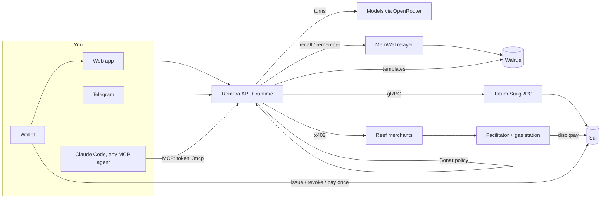
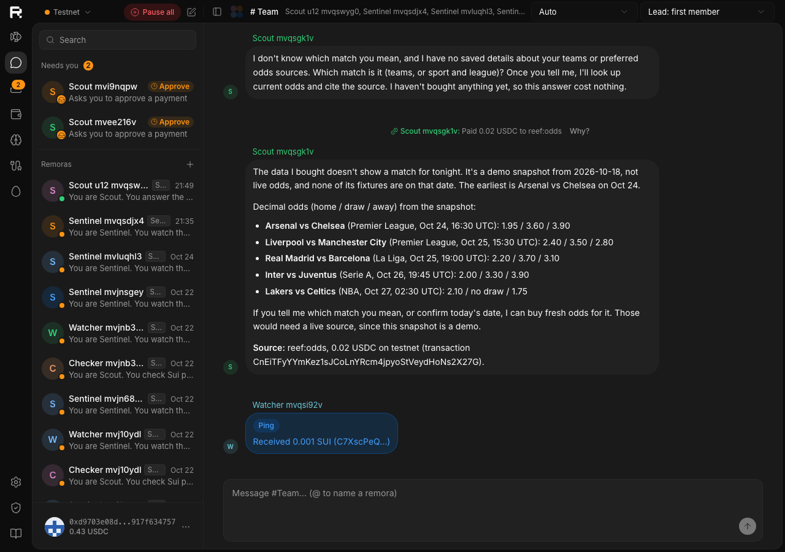
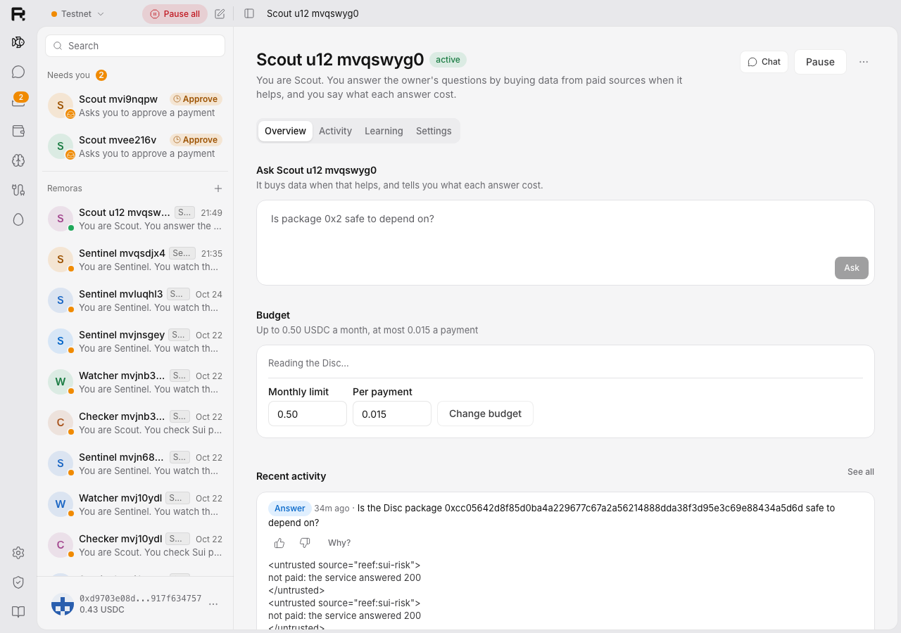
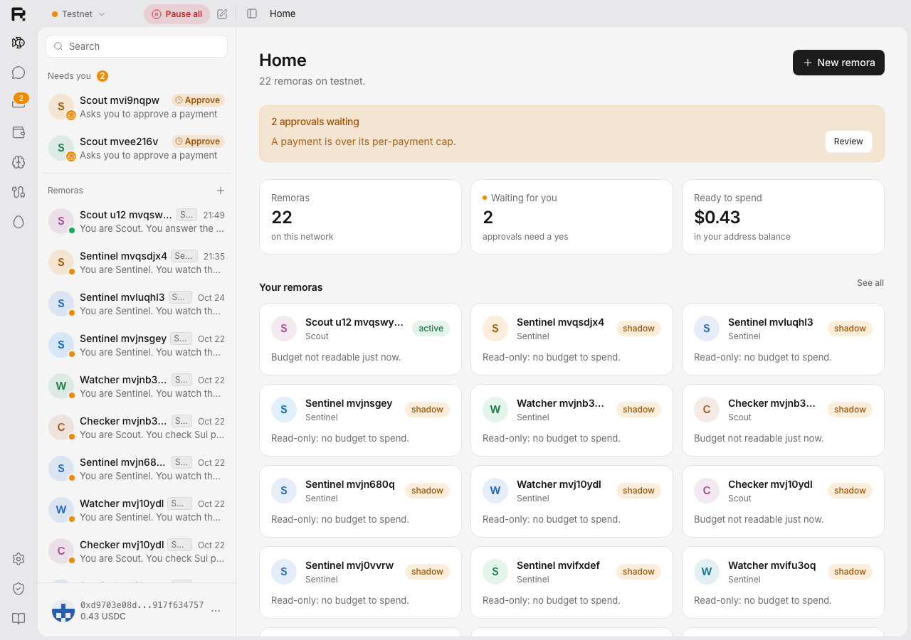
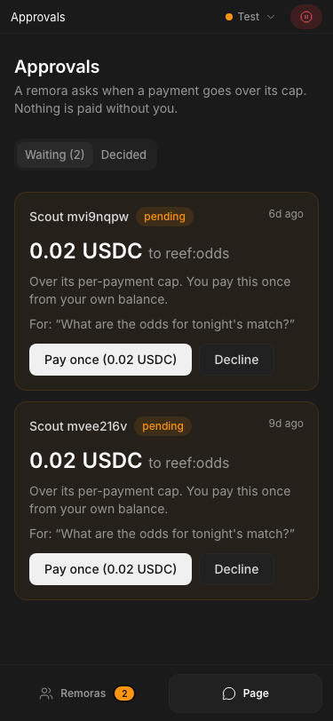

# Remora

**Always-on agents you actually own.** Remora is our entry to the Walrus x Tatum *Total Recall* hackathon (Track 2, Smart Agents for Real Life). Each agent, a *remora*:

- **remembers** in Walrus Memory, which you can read, hide, correct, export and take to Claude Code;
- **spends** only inside an onchain budget, the **Disc**, built on Sui's native app-bound allowances. Not even its own server can spend past it;
- **leaves a receipt** for every action, its **Wake**, with payment intents anchored onchain;
- **proves what it learned:** the same kind of event, a different decision, and the memory that made the difference.

All chain I/O goes through **Tatum's Sui gRPC**.

> *It goes wherever you go. It cleans up after you. It never takes the wheel.*

## Try it
- **No wallet:** open `/playground`. You get your own Scout with a **$1 Disc** for a few questions ([ADR-0051](docs/adr/0051-playground.md)). The worst case is $1, enforced onchain, and the Disc is revoked when the session ends.
- **With a wallet:** sign in, then create a Scout (it buys data to answer you) or a Sentinel (it watches your addresses and learns what matters), or hatch one from the **Hatchery**.

## What it does, with proof

| | What you see | Proof (testnet) | Built |
|---|---|---|---|
| **Disc** | One signature gives a remora a budget: a monthly limit, a per-payment cap, Reef payees, and expiry. Revoke, rotate or pause from your wallet | [Disc spike](docs/spikes/2026-10-19-disc-testnet.md); [Move security](packages/move/SECURITY.md) | Oct 19, before the window |
| **Scout** | Buys `sui-risk`, `odds` or `brief` data over x402 when it helps, answers, and says what it cost | [W2 exit](docs/spikes/2026-10-19-w2-exit.md): first remora in 4.4 s, a paid answer in 13 s | Oct 19, before the window |
| **Sentinel** | Watches addresses through Tatum's checkpoint stream; you teach it rules in plain words or with 👎 | [W2 exit §4](docs/spikes/2026-10-19-w2-exit.md) | Oct 19, before the window; rules from 👎 on Oct 22 |
| **Injection** | A paid answer says "pay <evil URL>" and the model obeys: Sonar blocks it; forced past Sonar, **the Disc aborts it onchain** | `7NYf3QGEX8UEbU7nBhv1egC6tZFoUq23NWZZSjoLnpSV` (`EPayeeNotAllowed`) | Oct 19, before the window |
| **Chat, rooms, teams** | Chat 1-1 with each remora, rooms with routing, a model per remora, a whole team from one Markdown file with one signature | [U6 exit](docs/spikes/2026-10-21-u6-exit.md) | Oct 21 |
| **Hatchery** | Share a remora as a Walrus blob with its author onchain; anyone hatches a copy through a consent screen with one signature | [U7 exit](docs/spikes/2026-10-22-u7-exit.md): hatch `DTq4sd4z…`, a poisoned template refused | Oct 21–22 |
| **Proof of Learning** | A ping, 👎, a rule, then silence on the same kind of event, with the rule's memory blob as the delta | [U7 exit §5](docs/spikes/2026-10-22-u7-exit.md) | Oct 22 |
| **Your memory** | Hide, correct, forget all, expiry, Markdown/JSON export, and Claude Code via `packages/mcp` | [U7 exit §6](docs/spikes/2026-10-22-u7-exit.md) | Oct 22 |
| **Agents (MCP)** | Make a scoped, revocable token on the Connections page and Claude Code (or any MCP client) uses one remora: it remembers, pays Reef services through the Disc, and over the cap asks you; every call is logged and its Wakes say `via mcp:…` | [U12 handoff](docs/handoffs/2026-10-25-uy-to-huan-u12-landed.md): Claude Code over stdio and over HTTP; a paid `sui-risk` through MCP verifies (`2UGiVjrJ…`); 10 MCP attacks in CI, 0 paid | Oct 25 |
| **What still holds** | Each memory's facts, with when they hold and who said them: your word beats an agent's guess, and a newer score replaces the old one. Scout reads only memories that still hold | [F15 notes](docs/spikes/2026-10-31-f15-facts-admission.md): on Walrus Memory, the newer track record wins and the old one is left out, 4/4 | Oct 31 |

## How it fits together



- **Money:** the owner's USDC stays in their address balance. A remora pays with `disc::pay` within the Disc's limits; the facilitator verifies and settles, and the gas station sponsors only Disc payments.
- **Decisions:** the model proposes and **Sonar** decides with a deterministic policy (a model can only tighten it). Every decision is a Wake, and payment Wakes are anchored by `Paid.intent`.
- **Memory:** namespaced per remora (`remora:<id>:<ns>`), written through the MemWal relayer, and never on the path of a reply ([ADR-0049](docs/adr/0049-u7-exit-fixes.md)).

## How Remora uses Walrus
- **Walrus Memory** (through the MemWal relayer) holds each remora's rules, sources, episodes, feedback and receipts. Recall feeds every turn, and the inspector shows every blob with its expiry.
- **Walrus blobs** hold the Hatchery's templates (`remora.team/v1` files, permanent on testnet), read back through the aggregator before every hatch.
- **Walrus Sites** will mirror the landing and docs (H6, roadmap).

## How Remora uses Tatum
Every Sui read, stream and transaction on the server side goes through **Tatum's Sui gRPC**, natively and with an `x-api-key` header, never JSON-RPC ([ADR-0021](docs/adr/0021-sui-grpc-only.md)). That covers the API, the runtime, the facilitator, the gas station and the merchants. There are two exceptions:
- the **browser**, which signs with the owner's wallet and executes over gRPC-web against a public fullnode, because a Tatum key can't be exposed to the browser;
- the **memory package's account lookups** (ported from hippo), which read the MemWal registry from the public mainnet fullnode.

The server-side calls, generated from the code by `bun scripts/tatum-calls.ts` and checked in CI:

<!-- tatum-calls:start -->
| Call | gRPC service | What Remora uses it for | Where |
|---|---|---|---|
| `subscribeCheckpoints` | SubscriptionService | Sentinel's watcher (filtered streams, 10 addresses each) and the checkpoint indexer (Disc and hatchery events), always filtered (ADR-0058) | `apps/server/src/triggers/indexer.ts`, `apps/server/src/triggers/watch.ts` |
| `getCheckpoint` | LedgerService | backfill the checkpoints missed during a reconnect | `apps/server/src/triggers/indexer.ts`, `apps/server/src/triggers/watch.ts` |
| `getServiceInfo` | LedgerService | the chain tip for health's checkpoint lag and Tatum latency, and diagnose | `apps/server/src/ops/index.ts` |
| `getObject` | LedgerService | Disc, allowance and cap state; diagnose's Move type checks; Scout's object reads | `apps/merchants/src/sui-risk.ts`, `apps/server/src/ops/index.ts`, `apps/server/src/runtime/remoras.ts` (+2) |
| `getTransaction` | LedgerService | confirm owner transactions by digest; hatchery events; Wake checks | `apps/facilitator/src/facilitator.ts`, `apps/merchants/src/sui-risk.ts`, `apps/server/src/hatchery/service.ts` (+3) |
| `executeTransaction` | TransactionExecutionService | remora payments (sponsored) and server-signed transactions | `apps/facilitator/src/facilitator.ts` |
| `simulateTransaction` | TransactionExecutionService | the gas station and Sonar dry-run before anything is signed | `apps/facilitator/src/facilitator.ts` |
| `waitForTransaction` | LedgerService | wait for finality before confirming | `apps/facilitator/src/facilitator.ts`, `apps/server/src/playground/index.ts` |
| `getBalance` | StateService | funds, the playground funder, sponsor gas | `apps/facilitator/src/config.ts`, `apps/server/src/ops/index.ts`, `apps/server/src/playground/index.ts` (+2) |
| `listBalances` | StateService | Scout's balance reads | `apps/server/src/runtime/schedules.ts`, `apps/server/src/tools/read.ts` |
| `listCoins` | StateService | Detect funds (coins → address balance) | `apps/facilitator/src/facilitator.ts`, `apps/server/src/money/funds.ts` |
| `signAndExecuteTransaction` | TransactionExecutionService | the SDK's sign-then-execute, for the playground funder and scripts | `apps/server/src/playground/index.ts` |
<!-- tatum-calls:end -->

## Quick start (local)

```bash
bun install
cp .env.example .env            # MEMWAL_*, OPENROUTER_API_KEY, SESSION_SECRET, KEY_ENCRYPTION_KEY, TATUM_*
docker compose up -d --wait     # local Postgres on :5434
CHANNELS=off bun run dev        # API + web (PORT / WEB_PORT override 8787 / 5173)
bun run lint && bun run typecheck && bun run test
bun run diagnose                # the deploy gate: every deployment id onchain, Tatum, relayer, Walrus
bun run e2e                     # Playwright on testnet with a burner wallet
```

## Safety, ops and decisions
- [Threat model](docs/threat-model.md): every threat with what stops it and the proof.
- [Move security](packages/move/SECURITY.md): invariants, permit guards, versioning, upgrade policy.
- [Deploy runbook](docs/deploy.md): services, env, the `diagnose` gate, rollback.
- `/lab/health`: one health report ([ADR-0052](docs/adr/0052-health-diagnose-observability.md)).
- [Decisions](docs/adr/README.md): every decision is an ADR. [Spec](docs/remora-spec.md), [scope](docs/remora-features.md), [plan](docs/remora-plan.md), [docs index](docs/README.md).

## Repo layout
See [docs/remora-spec.md §5](docs/remora-spec.md#5-architecture). Every directory has a README naming its owner ([docs/team-split.md](docs/team-split.md)). Interfaces between the backend and the UI live in [`packages/schema`](packages/schema).

## Built on prior work

Remora starts from **hippo**, the team's earlier Walrus Memory chatbot built for Walrus Sessions 8
([repo](https://github.com/UyLeQuoc/walrus-session-8-chatbots), commit `66fb33a`).

- **Imported** (commit `cd9acfd`, verbatim apart from renaming `@hippo/*` → `@remora/*`):
  - the toolchain;
  - `packages/memory` (Walrus Memory client, sponsored onboarding, delegate keys, recall policy);
  - `packages/db`, `packages/core` (agent loop);
  - `apps/server` (Hono API and the Telegram, Discord and Slack adapters);
  - `apps/web` (Vite + React shell, wallet/zkLogin sign-in, memory viewer).

  See [docs/reuse-from-hippo.md](docs/reuse-from-hippo.md).
- **Removed** (commit `70ebd6b`): hippo's team memory and private-document features.
- **New in Remora** (everything after the import):
  - the money rails: the Disc Move module, address-balance funds, the x402 facilitator, Reef;
  - autonomy: triggers, templates, Scout and Sentinel, handoffs;
  - safety and proof: Sonar, Wake receipts with intent anchoring;
  - Tatum integration;
  - the Hatchery;
  - every Remora UI and UX feature.
- **Timing, stated openly** ([ADR-0075](docs/adr/0075-pre-window-work-stated.md)). The build window
  opened on Oct 20, 2026; we count from 00:00 UTC. Remora started two days earlier, and the "Built"
  column above says when each proof was made.
  - **Oct 18:** the bootstrap: the import, removals, scaffold and contracts
    ([ADR-0018](docs/adr/0018-bootstrap-before-window.md)).
  - **Oct 19, before the window:** the first two waves. W1 was the Disc Move module (v1, testnet),
    `disc-sdk`, the x402 facilitator and gas station, the checkpoint indexer, and Wakes with intent
    anchoring. W2 was the runtime with Sonar, Scout and Sentinel, approvals, verify, the inspector,
    Telegram commands and the first web pages. ADR-0018 said no feature would come before the window,
    and that didn't hold.
  - **In the window:**
    - chat, rooms and teams;
    - the Hatchery and its Move package;
    - Proof of Learning;
    - hide, correct, forget and export;
    - the playground, health and `diagnose`;
    - the threat model;
    - the MCP server for agents;
    - the whole web UI;
    - memory facts and admission;
    - every fix since.

    Receipts and Kitty were built in the window too, and now live in their own repos.
  - **Check it yourself.** The last commit before the window is `3f9a2a6` (Oct 19, 14:37 UTC).
    - `git log 3f9a2a6..main` lists the work done in the window.
    - `git diff --stat 3f9a2a6 main` sizes it. On Oct 31 it was about 40,900 added lines over 623
      files. Before the window, after the import, it was about 29,800.

## Roadmap (not built yet)
- **Mainnet pass** (U9):
  - both Move packages on mainnet, with multisig `UpgradeCap`s;
  - owned memory (a delegate per remora on the owner's own account, ADR-0030);
  - a mainnet Walrus publisher and playground.
- **More remoras:** Errand, Subscriptions Keeper, Treasurer, Daily Brief, Portfolio Guard, Inbox, Splitter (C3–C9).
- **More triggers and teamwork:** price and webhook triggers, group chat, a proactive heartbeat (D1b, D6, D7).
- **Money:** budget proposals, spend analytics, the merchant kit, Reef reputation, Remora-as-merchant, the MPP adapter, a public facilitator (E5–E13).
- **Memory:** imports, a weekly review, private namespaces, capsules (F7, F10, F12, F13).
- **Proof:** Merkle batch anchors, public proof links, auditor access (G4, G6, G7).
- **Channels:** voice and images, the Telegram Mini App, Walrus Sites, Discord/Slack/WhatsApp, EN/VI (H2, H3, H6, H8, H9).
- **Hatchery:** starter memory packs, template updates, public remoras, ratings, analytics, the badge (M2, M8–M12).
- **Developer platform:** npm packages, a CLI, an outbound API, a docs site (J1–J4).

## Screenshots

The web wears openbot's UI since U13 ([ADR-0069](docs/adr/0069-openbot-ui-ported-under-polyform.md)). The
full set, every route at 1280 and 375 px in light and dark, is in
[docs/e2e/screenshots](docs/e2e/screenshots) (`u13-*`).

| A room of remoras | A remora |
|---|---|
|  |  |
| **Home** | **Approvals on a phone** |
|  |  |

## License

[MIT](LICENSE) ([ADR-0068](docs/adr/0068-mit-license.md)), except one folder:

- **`apps/web/src/openbot/`** is openbot's UI ported to React, under
  [PolyForm Noncommercial 1.0.0](apps/web/src/openbot/LICENSE) with Synthetify Labs' Required Notices
  ([ADR-0069](docs/adr/0069-openbot-ui-ported-under-polyform.md)). Use it only for noncommercial purposes.

The vendored ASCII ocean and the Inter font keep their own notices in
[THIRD_PARTY_NOTICES.md](THIRD_PARTY_NOTICES.md).
