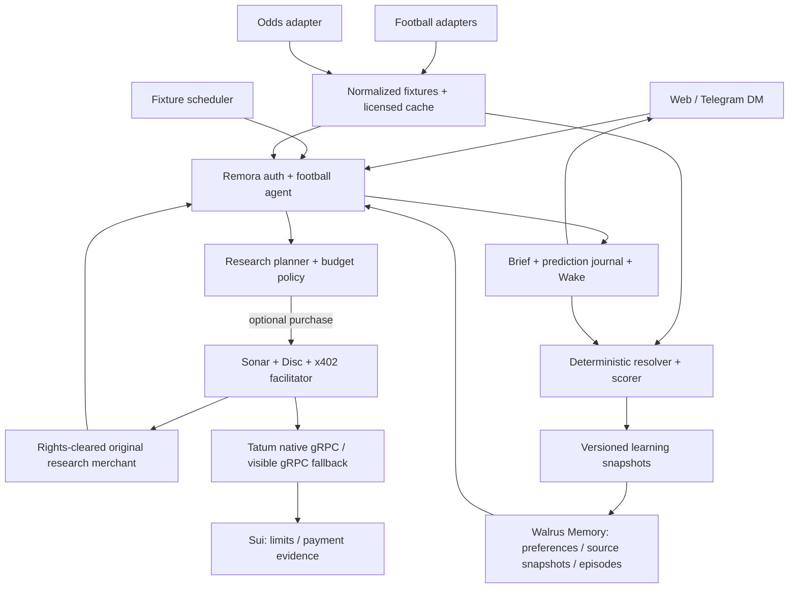

# PRD — VAR / Touchline: trợ lý bóng đá có trí nhớ

> Phiên bản: 1.0 · Ngày: 2026-11-04 · Ngôn ngữ: tiếng Việt.
> Track mục tiêu theo yêu cầu hiện tại: **Track 2 — Smart Agents for Real Life**.
> Trạng thái: **đặc tả đề xuất, chưa triển khai**. Tên VAR / Touchline là working title.
> Phạm vi công việc lần này: viết PRD, nghiên cứu API và ghi ADR; không đổi ship set, contract,
> database, deployment hay submission hiện tại của Remora.
> Liên quan: [ADR-0108](../adr/0108-football-agent-prd.md),
> [scope Remora](../remora-features.md), [spec](../remora-spec.md),
> [plan](../remora-plan.md), [ownership](../team-split.md).

## 0. Tóm tắt quyết định sản phẩm

**Một agent theo dõi bóng đá cho bạn: nhớ CLB và giờ nhận tin, nghiên cứu trước trận trong ngân sách,
lưu nhận định trước giờ bóng lăn, rồi học từ kết quả để chọn nguồn tốt hơn ở trận tiếp theo.**

- **Touchline** là năng lực agent: theo dõi, nghiên cứu, mua phân tích và chủ động gửi brief.
- **VAR** là trải nghiệm dễ nhớ: nhật ký dự đoán, bằng chứng, phản hồi sau trận; về sau mở ra group.
- Với **Track 2**, agent và thay đổi hành vi qua memory là câu chuyện chính. Một leaderboard pick'em
  đứng riêng phù hợp **Track 1 — Markets & Sports Prediction** hơn. Hai track có tên chính thức như
  trên; PRD không đổi tên track Sport thành Track 2. [S1]
- Tận dụng Remora như một football vertical: giữ signing, ngân sách, receipts, memory, chat và vận hành.
  Không tạo blockchain stack, wallet stack hay facilitator thứ hai.
- P0 phục vụ **một người dùng, một giải, một agent**, web + Telegram DM. Group nhiều người là P1.
- Gói dữ liệu đề xuất cho trải nghiệm đầy đủ: **API-Football Pro ($19/tháng)** cho fixtures/context,
  cộng **The Odds API Starter (500 credits/tháng, $0)** cho odds. Đây là đề xuất mua, chưa đăng ký
  hoặc thanh toán. Chạy thử quyền truy cập trước khi chốt. [S2][S6]
- Phương án $0: **football-data.org Free + The Odds API Starter**, bỏ cam kết lineups/injuries;
  score và lịch của football-data.org Free có độ trễ. [S4]
- Football provider là HTTP API ngoài chain. Tatum dùng để đọc/verify/thực thi Sui qua **gRPC**;
  không mô tả Tatum là API kết quả bóng đá.
- x402 chỉ bật cho sản phẩm nghiên cứu mà mình có quyền cung cấp. Không bọc raw API-Football hoặc
  The Odds API rồi bán lại. [S3][S8]

### 0.1 Điều gì đã xác minh, điều gì chưa

Ngày 2026-11-04 đã đọc tài liệu và trang giá chính thức trong danh mục nguồn ở §24; đã đọc các file
code được dẫn ở §8. **Chưa gọi API bóng đá có authentication, chưa kiểm tra entitlement của account,
chưa đo latency/coverage thực tế, chưa chạy repo Receipts riêng, chưa benchmark dự đoán.**

Reuse audit bắt đầu ở commit `a8cd710`, sau đó đối chiếu lại phần runtime/odds thay đổi khi checkout
tiến đến `84a1a65`. ADR-0106/0107 đã ghi kế hoạch U16 với thêm services và Briefer; đây là công việc
song song, chưa coi các năng lực dự kiến đó là dependency đã hoàn thành của football MVP.

Giá/quota là ảnh chụp thông tin ngày nghiên cứu, không phải báo giá cố định. TTL, budget, KPI và ngưỡng
thống kê dưới đây là **đề xuất thiết kế**, không phải khả năng/SLA do vendor cam kết. Mọi ví dụ nhận
định và số liệu người dùng là minh họa, không phải kết quả dogfood.

## 1. Vấn đề và cơ hội

Fan bóng đá phải ghép lịch thi đấu, phong độ, đội hình và nhận định từ nhiều nơi. Chatbot có thể viết
một preview nghe hợp lý nhưng thường không chứng minh được dữ liệu có trước trận, không nhớ nguồn
nào từng sai và không kiểm soát được chi phí nghiên cứu lặp lại.

Trong group, người dự đoán sai dễ bị quên còn người đoán đúng nhắc mãi một trận. Đếm số lần đúng cũng
không phân biệt được người dự đoán 55% với người nói chắc 99%. Tình yêu CLB có thể làm mức tự tin
không tương ứng với lịch sử thực tế.

Sản phẩm giải quyết ba việc nối tiếp nhau:

1. **Trước trận:** tìm thông tin có nguồn và biết còn thiếu gì.
2. **Đến giờ khóa:** lưu nhận định cùng tập dữ liệu, memory và policy đã dùng.
3. **Sau trận:** chấm theo quy tắc cố định, cập nhật memory và thay đổi hành động tiếp theo.

Lợi thế cạnh tranh cần chứng minh là **trí nhớ có thể kiểm tra và hành vi nghiên cứu có giới hạn chi
phí**. Chưa có cơ sở để hứa dự đoán tốt hơn thị trường hay tạo lợi nhuận.

## 2. Người dùng, JTBD và giá trị

| Persona | Job to be done | Thành công đối với họ |
|---|---|---|
| Fan bận rộn | Theo dõi đội yêu thích mà không đọc năm app | Một brief đúng giờ, đủ ý và đúng mức chi tiết |
| Fan thích phân tích | Lưu nhận định và biết mình thường sai ở đâu | Lịch sử trước trận, calibration và lời giải thích có chứng cứ |
| Admin group, P1 | Giữ trò chơi dự đoán công bằng và vui | Picks khóa đúng giờ, scoreboard dễ chia sẻ, không ai sửa sau trận |
| Giám khảo | Kiểm tra agent có thực sự học và dùng Sui/Walrus | Mở được memory, receipt, giao dịch và so sánh trước/sau |

**JTBD chính:** “Khi đội mình sắp đá, hãy chuẩn bị cho mình một nhận định ngắn có dẫn nguồn, tự tìm
thêm bằng chứng trong hạn mức mình đặt và lần sau nhớ những gì lần này đã làm sai.”

Không yêu cầu đăng ký wallet trước khi người dùng đọc một brief mẫu. Muốn tạo agent, bật chi tiêu,
lưu memory và đồng bộ Telegram thì dùng account/linking hiện có của Remora. Không tạo danh tính
wallet khác chỉ cho bóng đá.

## 3. Định vị và tên sản phẩm

**Tên làm việc:** “VAR — powered by Remora”, agent mặc định tên “Touchline”. Chốt thương hiệu và
kiểm tra tên miền/trademark là việc sau, chưa nằm trong PRD này.

**Pitch tiếng Việt:** “Trợ lý bóng đá nhớ bạn thích xem gì, nhớ nguồn nào đáng tin và cho bạn biết
nó đã chi bao nhiêu để tìm câu trả lời.”

**Pitch demo:** “Last match, it bought a report that added nothing. This match, it remembers — and
spends differently. Here are both receipts.” Chỉ dùng câu này khi có hai hành động thật để chứng minh.

**Ranh giới Track 2:** must-have là một agent chủ động, ghi nhớ và hành động trong giới hạn. Pick journal
là cách đo learning. Không biến roadmap thành thêm một entry Track 1; ADR-0001 vẫn có hiệu lực.

## 4. Mục tiêu, phi mục tiêu và nguyên tắc

### 4.1 Mục tiêu

- Từ một CLB/giải yêu thích đến một brief có nguồn trong một phiên onboarding.
- Chạy được vòng đời fixture → brief → prediction → result → memory → next decision.
- Người dùng mở được “Vì sao?” để thấy dữ liệu, memory, thời gian và chi phí.
- Agent không vượt Disc, không mua trùng khi retry và không nói đã mua khi thanh toán thất bại.
- Phân biệt rõ dữ liệu thật, backfill, replay và fixture minh họa.
- Có ≥10 memory đã thực sự lưu trên Walrus mainnet cho bài dự thi; số lượng không thay cho chất
  lượng learning. Checklist chính thức còn yêu cầu demo/repo và blog về learning. [S1]

### 4.2 Ngoài phạm vi P0

- Đặt cược, giữ tiền cược, pool thưởng hoặc tự giao dịch trên prediction market.
- Live commentary từng giây, video highlight, dữ liệu player tracking hoặc mô hình xG tự huấn luyện.
- Exact score, handicap châu Á, player props và nhiều market cùng lúc.
- Group nhiều chủ sở hữu, bảng xếp hạng toàn cầu, chống Sybil hoặc reputation token.
- Module Move mới, sealed picks, oracle phi tập trung hoặc phát hành tài sản.
- Thu thập nội dung hàng loạt từ social media, scraping không có hợp đồng API.
- Thay đổi deployment/mainnet payment policy của Remora hoặc hứa xóa blob Walrus ngay lập tức.

### 4.3 Nguyên tắc

Freshness trước độ dài; thừa nhận thiếu dữ liệu; phép toán ngoài LLM; quyền chi tiêu ngoài prompt;
quyền riêng tư trước tính lan truyền; kết quả thất bại cũng phải xuất hiện trong learning report.

## 5. Phạm vi ưu tiên và feature IDs

Các ID `FB-*` là ID hoạch định riêng, chưa thêm vào 69-feature ship set. Liên hệ feature Remora nằm
ở §8; commit thực thi sau này cần tên feature theo convention của repo.

| ID | Ưu tiên | Năng lực | Điều kiện nghiệm thu chính |
|---|---|---|---|
| FB-01 | P0 | Chọn giải/CLB, ngôn ngữ, múi giờ, quiet hours | Preference hiện lại sau phiên mới; sửa được |
| FB-02 | P0 | Fixtures và danh tính trận chuẩn hóa | Có provider ID, kickoff UTC, status, freshness |
| FB-03 | P0 | Brief theo yêu cầu và lịch trước trận | Có nguồn, thời gian, missing data, không nhân đôi thông báo |
| FB-04 | P0 | Odds baseline | Chuẩn hóa đủ 1/X/2; thiếu outcome thì unavailable |
| FB-05 | P0 | Nhật ký xác suất trước trận | Một binary market, revision bất biến, khóa server-side |
| FB-06 | P0 | Resolve và Brier | Kết quả 90 phút, trạng thái pending/void/disputed rõ ràng |
| FB-07 | P0 | Learning loop thực sự đọc memory | Snapshot mới ảnh hưởng lựa chọn/thông báo, có blob citation |
| FB-08 | P0 | Why, chi phí, trạng thái memory | Không lẫn accepted với stored; breakdown phí minh bạch |
| FB-09 | P0 | Degraded mode và quyền riêng tư | Outage không sinh odds/kết quả giả, người khác không đọc được |
| FB-10 | P0 có gate | Mua một research report qua x402 | Rights, merchant readiness và testnet settlement qua gate §10 |
| FB-11 | P1 | Group nhiều người và trust theo voice | Membership/auth/consent riêng, không dựa vào room hiện tại |
| FB-12 | P1 | Chứng thực pick trước khóa trên Sui | Payload/proof và chain timestamp đều kiểm tra được |
| FB-13 | P1 | Polymarket disagreement | Mapping đúng market và cùng điều kiện resolve |
| FB-14 | P1 | Kiểm chứng pundit | Người dùng duyệt extraction trước khi ghi nhận |
| FB-15 | P2 | 3-way, thêm giải, advanced context | Dữ liệu và sample đủ, không đổi scoring giữa mùa |

FB-10 là điều kiện để kể câu chuyện agent payments; nếu gate chưa qua, phát hành bản read-only và
ghi rõ chưa hoàn thành payment slice, không gắn nhãn đó là full MVP của PRD.

## 6. Hành trình người dùng

### 6.1 First run

1. Đọc preview mẫu với nhãn “minh họa”. Chọn giải và CLB; P0 đề xuất Premier League nếu coverage qua spike.
2. Đăng nhập bằng flow hiện có. Chọn VI/EN, múi giờ mặc định theo trình duyệt, brief T−24h/T−30m.
3. Chọn read-only hoặc “cho phép mua nghiên cứu”. Phần chi tiêu phải giải thích cap và payee bằng tên.
4. Nếu bật chi: dùng funding/Detect funds, Disc và approval flow hiện có; không tự chuyển Coin model.
5. Link Telegram DM bằng flow account linking đã có hoặc chỉ dùng web.
6. Nhận fixture thật sắp tới. Nếu chưa có trận hợp lệ thì hiển thị empty state; không dựng trận giả.

Mặc định không ping trong quiet hours; brief được gom đến giờ cho phép. Một trận vào đêm khuya vẫn
hiển thị kickoff ngày địa phương chính xác. Người dùng có thể chọn ngoại lệ riêng cho đội yêu thích.

### 6.2 Trước trận: brief và mua thêm bằng chứng

Người dùng hỏi “Tối nay Arsenal đá có gì đáng chú ý?”. Agent resolve tới fixture duy nhất; nếu có
nhiều trận/đội cùng tên, yêu cầu chọn trong UI. Nhận dạng tiếng Việt dùng structured fixture selection
và aliases; regex tiếng Anh của Scout hiện tại không đủ.

Brief gồm:

- Trận, giải, giờ đá và “dữ liệu cập nhật lúc …”.
- 3–5 điểm chính có evidence reference; đội hình chỉ gọi là confirmed nếu provider xác nhận.
- Odds baseline dưới dạng xác suất; không có dữ liệu thì không có phần trăm tự bịa.
- Điều còn chưa biết và điều gì có thể làm nhận định thay đổi.
- “Lần này đã chi …” và nút “Vì sao?” / “Lưu nhận định” / “Bớt thông báo”.

Agent lập kế hoạch trước mỗi lần mua: câu hỏi cần trả lời, gap hiện tại, nguồn dự định mua, giá và
thời hạn còn hữu ích. Fresh cache hoặc report đã sở hữu phải được dùng lại. Nếu hết budget, nó trả
lời từ bằng chứng còn có và nêu giới hạn. Không coi thay đổi giá market là lợi nhuận tiềm năng.

### 6.3 Lưu dự đoán

Câu hỏi P0: **“Đội chủ nhà có thắng trong 90 phút cộng bù giờ không?”** Xác suất là `P(home_win_90m)`
từ 0.01 đến 0.99. UI giải thích “hòa hoặc đội khách thắng = không”. Chọn đội khách thắng 70% không
tương đương `P(home)=30%`, vì còn hòa; không tự chuyển đổi như vậy.

Người dùng lưu xác suất và lý do; agent lưu xác suất riêng ở cùng cutoff. Sửa trước cutoff tạo revision
mới, không ghi đè. Đến cutoff, revision hợp lệ cuối cùng là bản được chấm. Lý do có thể là nhận định
chủ quan; không coi nó là fact football. Xác nhận lưu nêu rõ trạng thái local/memory/chain riêng.

### 6.4 Sau trận

Agent nhận result hợp lệ, chấm Brier và cho thấy xác suất trước trận. Report chia “đúng/sai kết quả”,
“mức tự tin” và “nguồn thông tin hữu ích” thành ba phần khác nhau. Một trận đúng không đủ kết luận
người dùng giỏi; một trận sai không đủ kết luận nguồn dở.

Memory mới chỉ lưu kết luận có evidence IDs và sample size. Trận kế tiếp đọc lại snapshot này;
“Vì sao?” chỉ ra memory nào thực sự được admission cho phép dùng. Người dùng có thể sửa preference,
ẩn/correct một memory hoặc tắt agent.

### 6.5 Group, sau P0

Admin tạo group, member tham gia và đồng ý cho dùng picks trong tổng hợp. Mỗi member có principal
riêng; bot Telegram nhận dạng user ID đã link, không tin display name. Group cap không cho member
chi tiền của admin. Group report mặc định chỉ đọc, mọi purchase vẫn thuộc một owner/Disc xác định.

## 7. API bóng đá: nguồn, tradeoff và lựa chọn

### 7.1 Ma trận provider

| Nguồn | Vai trò đề xuất | Giá/quota đã đọc 2026-11-04 | Giới hạn và quyết định |
|---|---|---|---|
| API-Football / API-SPORTS | Fixtures, kết quả, context nếu được cover | Free 100 req/ngày; Pro $19/tháng, 7,500 req/ngày; Free giới hạn season [S2] | Pro là đề xuất cho bản đầy đủ; không giả định Free truy cập mùa 2026/27 |
| football-data.org v4 | Fixture/result cho bản $0, đối chiếu thủ công | Free 12 competitions, 10 calls/phút, schedules/scores delayed [S4] | Không hứa live, lineup hoặc injuries trên Free; fallback phải có mapping trước |
| The Odds API, **the-odds-api.com** | Bookmaker odds và timestamp | Starter 500 credits/tháng; 20K $30/tháng [S6] | P0 dùng h2h, một region; khác dịch vụ tên gần giống `theoddsapi.com` |
| Sportmonks | Phương án sau hackathon cho context sâu | Starter €29/tháng trả tháng, chọn 5 leagues [S9] | xG/odds và các add-on có giá riêng; chưa thêm vendor thứ tư vào P0 |
| Polymarket Gamma/CLOB | Market-price comparator P1 | Public market-data endpoints; chưa xác minh soccer coverage cho trận demo [S10] | Không dùng để xác nhận kết quả chính thức; không buộc phải có market mỗi trận |
| ESPN endpoint trong Receipts | Tham khảo spike cũ | Đã có ghi nhận nội bộ tại ADR-0061, chưa kiểm tra live lần này | Không chọn làm production dependency có SLA; không dựa vào undocumented feed để chốt MVP |

### 7.2 Stack đề xuất và fallback

**Bản đầy đủ:** API-Football Pro cho fixtures/context; The Odds API cho odds; Remora cho agent.
Tách odds để giữ một bookmaker baseline độc lập với nguồn context. “Hai vendor độc lập” không có
nghĩa nguồn gốc thông tin chắc chắn độc lập; gắn lineage khi biết có cùng upstream.

**Bản $0:** football-data.org Free cho lịch/kết quả, Odds Starter cho baseline; briefing chỉ dùng
những trường hiện có. Không bật paid research bằng cách bán lại feed miễn phí. Không tự động mua
plan khi Free thiếu entitlement. Owner chọn budget sau spike; việc viết PRD không mua gì.

**Fallback vận hành:** dùng cache hợp lệ trước, stale có nhãn sau, unavailable sau cùng. Không đổi
provider trực tiếp giữa trận nếu chưa có stable mapping và result semantics tương đương. Lỗi primary
không tự ghi đè kickoff hoặc tự resolve bằng secondary có fuzzy match.

### 7.3 Endpoint và authentication

Các route dưới là upstream reference để xây adapter, không phải API app đã có. Secret chỉ ở server;
placeholder không phải credential.

| Nguồn | Base / auth | Request tham chiếu | Dùng cho |
|---|---|---|---|
| API-Football | `https://v3.football.api-sports.io`, header `x-apisports-key` | `GET /leagues?country=England&name=Premier%20League` | Discover competition/season/coverage |
| API-Football | như trên | `GET /fixtures?league={leagueId}&season={seasonStartYear}&from={date}&to={date}&timezone=UTC` | Fixtures và kết quả |
| API-Football | như trên | `GET /fixtures?id={fixtureId}` | Refresh một trận |
| API-Football | như trên | `GET /fixtures/lineups?fixture={fixtureId}` | Confirmed lineup nếu có |
| API-Football | như trên | `GET /injuries?fixture={fixtureId}` | Context availability, optional |
| football-data.org | `https://api.football-data.org/v4`, header `X-Auth-Token` | `GET /competitions/PL/matches?dateFrom={date}&dateTo={date}` | Fixtures/result phương án nhẹ |
| football-data.org | như trên | `GET /matches/{matchId}` | Refresh result nếu entitlement cho phép |
| The Odds API | `https://api.the-odds-api.com`, query `apiKey` | `GET /v4/sports` | Discover active sport keys |
| The Odds API | như trên | `GET /v4/sports/soccer_epl/odds?regions=uk&markets=h2h&oddsFormat=decimal` | 1/X/2 snapshot |
| Polymarket, P1 | Gamma public API | `GET /sports`, `GET /events` | Discover events; không đoán slug |
| Polymarket, P1 | CLOB public API | `GET /prices-history?market={tokenId}&interval=1d&fidelity=10` | Comparator lịch sử đúng outcome |

API-Football lineups phụ thuộc coverage và có thể chỉ xuất hiện muộn hoặc sau trận. Thiết kế không
đòi lineup lúc T−60m. [S11] Endpoint/query fixtures, injury và mùa truy cập phải được xác nhận bằng
account thực ở spike; ngày tháng dùng UTC và season theo provider, không hardcode từ năm hiện tại.

Không log full URL The Odds API vì key ở query. Metrics chỉ ghi provider, route template, status,
latency, credit count và request ID. Pagination/empty response/error envelope phải xử lý trong adapter;
HTTP 200 chưa chắc đồng nghĩa request thành công hoặc có coverage.

### 7.4 Coverage spike trước build

Uy chạy bằng account dev/test, không xuất key ra log. Exit record cần:

1. Xác minh plan hiện tại, quota reset, league và season trả dữ liệu.
2. Lấy fixtures trong cửa sổ demo; chọn **một giải có trận thật**, không suy lịch từ ví dụ merchant.
3. Kiểm tra một fixture tương lai, một trận đã kết thúc, một record thiếu dữ liệu và pagination.
4. Xác minh odds đủ home/draw/away, timestamp, bookmaker và điều kiện 90 phút.
5. Kiểm tra lineup/injury coverage thực tế; lấy được rỗng không đồng nghĩa “không ai chấn thương”.
6. Ghi response đã scrub vào fixture test chỉ khi quyền lưu/redistribute cho phép; nếu không, dùng
   synthetic test fixtures và ghi rõ. Không commit raw feed/licensed assets chỉ vì repo public.
7. Đo call count, latency và result lag, ghi ngày kiểm tra; không biến một phép đo thành SLA.
8. Chốt primary, cache policy, rights của paid report và league. Fail một mục quan trọng thì cắt scope.

## 8. Reuse audit: code có gì và còn thiếu gì

“Có code” ở đây là đã đọc file trong checkout, không phải vừa chứng minh production E2E. Các README
con ghi scaffold có thể cũ; đối chiếu implementation cụ thể thay vì suy từ README đó.

| Năng lực | Bằng chứng trong repo | Cách dùng lại / khoảng trống |
|---|---|---|
| C1 Scout | [`scout.ts`](../../apps/server/src/runtime/scout.ts) | Tool loop, payment outcomes, admitted memories; thêm planner theo fixture và VI aliases, chưa có football research policy |
| B1 templates | [`templates/index.ts`](../../apps/server/src/templates/index.ts) | Template parse, payee refs; thêm football template cần hỗ trợ routing/runtime, không chỉ sửa persona |
| D1 triggers | [`cron.ts`](../../apps/server/src/triggers/cron.ts), [`schedule.ts`](../../apps/server/src/triggers/schedule.ts) | Cron UTC + schedule proposal; thêm job theo kickoff, reschedule/cancel và dedupe |
| D2 durable jobs | [`runtime/jobs.ts`](../../apps/server/src/runtime/jobs.ts) | Queue/retry foundation; cần kiểm tra semantics với fixture polling và result correction |
| H1/A5 Telegram | [`telegram.ts`](../../apps/server/src/channels/telegram.ts), [`remora-bot.ts`](../../apps/server/src/channels/remora-bot.ts) | DM delivery/linking; `/pick` và membership group là mới |
| D6 rooms | [`rooms.ts`](../../apps/server/src/runtime/rooms.ts) | Nhiều remora của cùng owner; **không** phải authorization cho nhiều fan |
| E1/E2 Disc | [`disc-sdk`](../../packages/disc-sdk/src/index.ts), `packages/move/remora` | App-bound caps/payee limits; không cần Move mới cho research purchase |
| E3/D8 payments | [`facilitator.ts`](../../apps/facilitator/src/facilitator.ts), [`gas-pool.ts`](../../apps/facilitator/src/gas-pool.ts) | Verify/settle/sponsor; kiểm tra delivery/retry sau payment ở §10 |
| E7/E8 Reef/merchant | [`merchant/x402.ts`](../../packages/merchant/src/x402.ts), `apps/reef` | Registry và paywall middleware; merchant nghiên cứu phải có rights và fulfillment contract |
| E9 odds | [`odds.ts`](../../apps/merchants/src/odds.ts) | Sample prices, kickoff demo được tạo theo ngày request và disclaimer; **không phải feed live**, timestamp mới không biến sample thành evidence thật |
| F1/F4 memory | [`runtime/memory.ts`](../../apps/server/src/runtime/memory.ts), [`policy.ts`](../../packages/memory/src/policy.ts) | Limiter, dedupe, async settlement, hide/correct; domain snapshot/schema là phần mới |
| F15 admission | [`runtime/facts.ts`](../../apps/server/src/runtime/facts.ts), [`admission.ts`](../../packages/memory/src/admission.ts) | Fact authority, stale/correction filtering; chỉ cite memory thật sự admitted |
| F2 source feedback | [`feedback.ts`](../../apps/server/src/runtime/feedback.ts) | useful/noise và cost/useful; **không** phải forecast accuracy hay causal source value |
| G1–G3 Wake | [`wake.ts`](../../apps/server/src/runtime/wake.ts), [`verify.ts`](../../apps/server/src/runtime/verify.ts) | Action receipts; chưa có bằng chứng hash exact football pick trước khóa |
| G5/L1 learning | [`learning.ts`](../../apps/server/src/runtime/learning.ts), [`learning.tsx`](../../apps/web/src/features/learning/learning.tsx) | Before/after và chart patterns; cần domain scoring/calibration và contract mới |
| H4/N2/N4 UI | `apps/web/src/features/remoras`, `approvals`, `verify`, `reef` | Shell, budget, approvals, Why; xây fixture/brief/journal views theo design system |
| I1/I2/I5 | `packages/sonar`, `packages/memory/src/redact.ts` | Untrusted content/redaction; không bảo đảm factual correctness của bài báo |
| K1/K2 chain | [`tatum.ts`](../../packages/chain/src/tatum.ts), [`fallback.ts`](../../packages/chain/src/fallback.ts) | Native gRPC, pacing, health; giữ fallback có nhãn khi Tatum hết credits theo ADR-0097 |

**Receipts riêng:** [ADR-0065](../adr/0065-split-receipts-and-kitty-repos.md) ghi repo
[total-recall-receipts](https://github.com/UyLeQuoc/total-recall-receipts) đã tách khỏi Remora.
[ADR-0061](../adr/0061-receipts-sources-and-design.md) mô tả binary picks, Brier, Merkle anchors và
memory trust. Có thể port sau khi audit commit/license/coverage/identity thực tế; PRD này chưa kiểm
tra repo riêng và không khẳng định các chức năng đó đang chạy trong Remora.

Không lấy phần `apps/web/src/openbot` như tài sản MIT mặc định: ADR-0069 ghi license riêng. Phần port
phải giữ notices và kiểm tra điều kiện reuse; không đổi license của toàn bộ UI. `reference/hippo`
giữ read-only. Không đưa “% code reuse” giả chính xác khi chưa ước lượng từng task.

## 9. Kiến trúc và luồng dữ liệu



### 9.1 Deployment và isolation

- Dùng server, web, Postgres, worker, merchants/facilitator sẵn có; không thêm microservice nếu adapter
  và worker trong app đủ dùng.
- Feature flag `football` mặc định off; route/cache/job đều có scope và kill switch. Đây là tên cấu
  hình đề xuất, chưa thêm biến env hay config.
- Không bật background football poller cho toàn bộ deployment chỉ để demo một owner.
- Football providers HTTP; server Sui native gRPC, browser gRPC-web. Không thêm JSON-RPC.
- Tatum là primary; fallback theo ADR-0097 phải hiển thị trong evidence. Không gắn nhãn fallback call
  thành Tatum call; không thêm wallet stream không phục vụ football workflow.
- Memory mainnet theo yêu cầu event; payments theo testnet/mainnet policy hiện hành. PRD không
  cấp quyền publish Move/deploy hay chuyển payment lên mainnet.

### 9.2 State machine

Fixture domain: `scheduled → live → finished`; nhánh `postponed`, `cancelled`, `abandoned`, `disputed`.
Mapping provider là explicit table có test, không dùng substring heuristic.

Brief: `queued → preparing → ready | partial | failed`; purchase có state riêng. Prediction:
`draft → accepted → locked → resolved | void | disputed`. Memory:
`pending → stored | failed`; proof: `unanchored → submitted → verified | late | failed`.

Không gộp các state thành một dấu tick xanh. Result correction tạo version mới và rescore có log;
prediction trước trận vẫn giữ nguyên.

## 10. Agent payments và quyền sử dụng dữ liệu

### 10.1 Phân biệt ba loại chi phí

1. **Subscription vendor:** đội phát triển trả tiền plan API bằng kênh vendor, không phải x402.
2. **Agent purchase:** agent trả USDC cho một research merchant; có Disc và giao dịch Sui thật.
3. **Chi phí vận hành:** model, gas, memory/storage và hạ tầng; theo dõi riêng, không cộng hai lần.

Một vòng HTTP fetch có API key không được gọi là “agent payment”. Merchant tự vận hành phải được ghi
rõ là demo merchant nội bộ, chưa phải marketplace bên thứ ba hoặc revenue đã có khách.

### 10.2 Rights gate bắt buộc trước paid football service

API-Football cấm bán lại trực tiếp dữ liệu nếu không có permission. [S3] The Odds API cho phép nhiều
user-facing applications nhưng cấm standalone raw data product/API. [S8]

Do đó không dùng `/odds` x402 như proxy thương mại của hai vendor. Phương án research merchant chỉ
được bật khi có **nội dung tự tạo/được cấp quyền**, output có giá trị phân tích riêng và quyền của
mọi upstream cho phép đúng kiểu sử dụng đó. Đổi tên raw payload thành “analysis” không vượt được gate.

Exit gate do Uy ghi vào spike:

- Nguồn input, điều khoản/version/ngày kiểm tra, quyền lưu cache và public display/export.
- Mô tả output, đối tượng nhận, việc có thu phí và mức độ chứa lại vendor data.
- Permission bằng văn bản nếu điều khoản không rõ với paid agent-to-agent API.
- Không phát tán raw feed vào Walrus, public repo, MCP export hoặc proof page.
- Chưa qua gate: disable paid vendor-derived output; có thể demo **report độc lập do team tự viết**
  bằng nội dung mình có quyền dùng, hoặc chạy practice mode và công khai chưa settle.

Không tự liên hệ vendor trong công việc viết PRD; đây là dependency cho implementation owner.

### 10.3 Hợp đồng mua và giao hàng

Research entitlement gắn `(owner, fixture, reportKind, snapshotVersion)`; price quote có expiry và
content freshness. Trước settlement phải kiểm tra có report giao được; lineup chưa có thì trả
`not_available` không thu phí. Request dùng idempotency key cố định qua retry.

Sau settle, delivery fail thì retry **cùng entitlement**, không charge lần hai. Timeout ambiguous:
tra ledger/giao dịch qua gRPC trước khi thử payment mới. Cần kiểm tra semantics hiện có của facilitator
và merchant, không giả định middleware tự xử lý tất cả. UI hiển thị “đã trả, đang lấy báo cáo”.

Provider quota/circuit breaker, ngoài Disc, ngăn retry storm và phí model vô ích. Không cho nguồn
content sửa `payTo`, request secret, tăng cap hoặc biến report thành lệnh gọi tool.

### 10.4 Research policy v1

Quy tắc có thứ tự, chưa cần contextual bandit:

1. Dùng cache/entitlement còn hạn; hỏi lại fixture nếu không xác định được.
2. Liệt kê missing evidence và thời gian đến cutoff. Không mua nếu report hết hữu ích trước delivery.
3. Đọc memory source theo league/report kind, loại stale/disputed/không đủ quyền scope.
4. Chọn tối đa **một** report/lượt; không mua chỉ vì market disagreement cao.
5. Kiểm tra payee allowlist, per-payment cap, remaining budget, cooldown và token budget.
6. Không đủ budget thì xin approval bằng flow có sẵn hoặc bỏ mua; model không tự tăng allowance.
7. Ghi planned/paid/delivered/used riêng. Chỉ nói “đã dùng nguồn X” khi thực sự có dữ liệu được dùng.

Giá thử nghiệm đề xuất cho merchant team tự vận hành: $0.01/report, tối đa $0.03/fixture,
$0.10/ngày và $1 tổng cho cohort demo. Đây là app policy; cần ánh xạ rõ cap nào Disc thực sự enforce,
cap nào DB/worker enforce. Không tuyên bố mọi cap đều onchain. Dollar cap tính bằng integer micro-USDC.

## 11. Dữ liệu chuẩn hóa và internal API đề xuất

### 11.1 Entity dictionary

| Entity | Trường tối thiểu | Invariant |
|---|---|---|
| Competition/Team | internal ID, provider mappings, canonical name, aliases | Mapping theo provider/season; tên không phải ID |
| Fixture | ID, competition, season, home/away, kickoff UTC, status, scheduleVersion | Mọi revision lịch giữ audit trail |
| SourceSnapshot | provider, fetchedAt, upstreamUpdatedAt nullable, content hash, rightsClass, coverage | Fetch mới không được làm timestamp dữ liệu cũ thành mới |
| OddsSnapshot | fixture, bookmaker, market, 3 odds, quoteAt, fetchedAt, overround | Không trộn outcomes từ bookmaker/time khác nhau |
| Brief | owner, fixture, cutoff, evidence refs, memory refs, policy/model version, costs | Mỗi fact có provenance hoặc nhãn nhận định |
| PredictionRevision | owner/voice, fixture, marketVersion, pHome, revision, acceptedAt, lockAt, briefRef | Append-only; 0.01 ≤ pHome ≤ 0.99 |
| Resolution | fixture, score90m, provider refs, status, version, reason | Score không null mới đủ resolve; dispute không tự chọn winner |
| LearningSnapshot | scope, asOf, sample size, algorithm version, evidence IDs, blob/index refs | Chỉ đọc kết quả biết trước asOf |
| ResearchEntitlement | owner, fixture, kind, snapshotVersion, quote, digest, delivery state | Retry không tạo lần charge mới |

Đây là logical model; migration, type và route phải qua contract PR. Không thêm trực tiếp vào
`packages/schema` trong công việc này, không chạy `db:push`.

### 11.2 Routes ứng dụng đề xuất

| Method / route | Auth và input | Output/behavior |
|---|---|---|
| `GET /api/football/fixtures` | Owner session; competition/date range có bounds | Fixtures kèm freshness/coverage |
| `GET /api/football/fixtures/:id` | Owner session | Detail, cached evidence metadata, không lộ key/raw paid feed |
| `POST /api/remoras/:id/football/briefs` | Owner của remora; fixtureId, idempotency key | 202 job + progress; reuse brief còn hợp lệ |
| `GET /api/remoras/:id/football/briefs/:briefId` | Owner scope | Brief hoặc preparing/partial/failed |
| `POST /api/remoras/:id/football/predictions` | Owner; fixtureId, pHome, rationale, expected revision | Append revision hoặc 409 locked/revision_conflict |
| `GET /api/remoras/:id/football/journal` | Owner; pagination/filter | Revision scored, pending, void tách rõ |
| `GET /api/remoras/:id/football/learning` | Owner | Brier, baseline, sample sizes, snapshots, missing-data counts |
| `PATCH /api/remoras/:id/football/preferences` | Owner; validated preferences | Version mới + scheduler reconciliation |

Route chỉ là đề xuất chưa tồn tại. Public share nếu làm P1 dùng allowlisted/revocable view như pattern
hiện có, không lấy private endpoint rồi bỏ auth. Internal worker resolve chỉ gọi trusted module/job;
không cung cấp public “set score” endpoint. Pagination, range caps và error shape thống nhất Remora.

## 12. Memory: lưu gì, đọc thế nào, học điều gì

### 12.1 Giữ kiến trúc thật của repo

`runtime/memory.ts` hiện dùng **operator account**, namespace tách theo owner/remora. Đây chưa phải
memory account riêng của từng fan. Không mô tả namespace như cryptographic access boundary; auth
app vẫn phải chặn cross-owner. Chuyển sang per-user account là quyết định riêng, ngoài P0.

Namespace names là public; không đưa Telegram handle, tên thật, group title hoặc API key vào namespace.
Giữ format/namespace builder trong memory package; domain slots cần hợp đồng chung, không nối chuỗi
trong route. MemWal có giới hạn và hành vi thực đo trong [tech-reference §1.11](../tech-reference.md).

### 12.2 Memory map đề xuất

| Domain record | Namespace/type có thể kế thừa | Nội dung bền vững |
|---|---|---|
| Preferences | `me` / `profile`, `style` | Club IDs, VI/EN, timezone, độ dài brief; owner-asserted |
| Notification rule | remora rules / `rule` | Khung giờ, không ping lineup rỗng, digest preference |
| Source quality | `sources` / `source` | Provider/report kind/league, freshness/coverage/usefulness có n/asOf |
| Prediction episode | remora episodes / `episode` | Prediction/result IDs, policy version, score, điều chưa biết |
| Calibration conclusion | remora episodes / `gotcha` | Confidence bin, n, gap; tentative khi sample nhỏ |
| Budget preference | `budget` / `budget` | Mức owner mong muốn, lý do đề xuất; không tự cấp quyền chi |
| Correction | domain liên quan / `correction` | Supersedes reference và phạm vi thời gian |

Postgres giữ số liệu domain, IDs, hash, timestamp, job state và index. **Không thêm cột sao chép memory
text**. Raw feed nếu được phép cache thuộc cache riêng có retention, không phải memory. Pending
write có thể cần durable outbox payload ngắn hạn đã scrub; owner quyết định persistence theo policy,
không mặc định lưu plaintext memory vĩnh viễn trong DB.

### 12.3 Ba learning loops tách biệt

**Loop A — preferences/notifications:** owner feedback → rule memory → brief tiếp theo thay đổi độ
dài/thời điểm. Đo tỷ lệ useful/noise và số lần vi phạm quiet hours; không dùng likes làm độ chính xác.

**Loop B — credibility/calibration:** predictions đã khóa + final result → tính điểm deterministic →
trust snapshot trên Walrus → lần dự đoán tiếp theo đọc snapshot và điều chỉnh trọng số theo policy.
P0 đánh giá agent và người dùng; voice weights của group là P1. Không gán weight cho raw lineup
provider theo Brier vì provider đó không phát xác suất dự đoán.

**Loop C — research economy:** delivery/freshness/coverage + feedback → source snapshot → planner
tránh report hay rỗng, dùng cache hoặc chọn nguồn hợp lệ khác. Cost per useful report là chỉ số
vận hành; muốn nói “nguồn làm dự đoán tốt hơn” cần paired ablation, không suy từ một trận thắng.

### 12.4 Đọc memory và degraded mode

- Recall bằng object form, admission theo scope/asOf và corrections. Snapshot thống kê lấy version
  mới nhất hợp lệ bằng index + reference; không dựa duy nhất vào similarity của câu hỏi.
- Những track-record số liệu thay đổi dùng `dedupe: false`; supersession rõ ràng, không bỏ vì gần giống.
- Recall lỗi: retry/bound timeout qua port hiện có, sau đó conservative baseline và nhãn “chưa đọc
  được lịch sử”; không nói “bạn chưa từng dự đoán” chỉ vì recall rỗng.
- Write async: `pending` khác `stored`. Chỉ blob đã xác nhận được mới tính vào ≥10 mainnet memories.
- UI hide/correct/forget phải nói đúng: hide là filter local, blob không bị xóa tức thì; expiry đọc
  từ metadata, không hứa cố định 210 ngày cho mọi blob.
- Không đưa raw provider feed hoặc bí mật vào Walrus. Consent riêng cho rationale nhạy cảm; P0
  lưu prediction số liệu chuẩn hóa và kết luận ngắn, không harvest toàn bộ chat.

## 13. Dự đoán và scoring chính xác

### 13.1 Market contract

`home_win_90m/v1`: đội chủ nhà thắng sau 90 phút cộng bù giờ; không gồm hiệp phụ/luân lưu. P0 ưu tiên
league fixtures để giảm khác biệt. Hòa là `y=0`, đội khách thắng là `y=0`; chủ nhà thắng `y=1`.
Friendly/knockout/awarded/walkover không được tự nhận như league fixture bình thường.

### 13.2 Khóa và tính toàn vẹn

Đề xuất cutoff P0: `kickoffAt - 5 phút`. Kiểm tra bằng server clock trong transaction khi append pick;
client countdown chỉ giúp UX. Worker lock muộn không mở thêm thời gian nhập. Live status đến sớm
hơn dự kiến thì khóa ngay. Scheduled job và request path phải cùng dùng một rule.

Lịch đổi trước cutoff: version schedule, reconcile jobs và thông báo. Lịch đổi sau khi đã khóa:
không tự mở lại. Postponed/cancelled/abandoned đi qua resolution policy dưới đây. Nếu feed xác nhận
trận đã bắt đầu trước cutoff cũ, flag những picks bị ảnh hưởng là ineligible/disputed, không chấm
như picks trước trận. Mất feed gần cutoff thì đóng nhận scored picks thay vì tin lịch stale.

**P0 “đã khóa” là guarantee do server enforce, chưa phải timestamp proof phi tập trung.** Wake của
research payment không tự chứng minh xác suất pick nếu payload đó chưa nằm trong hashed intent.
P1 mới dùng exact canonical pick hash + Merkle proof/anchor hoặc flow ký tương đương (§17).

### 13.3 Brier và bookmaker baseline

```text
y = 1 nếu home thắng 90 phút; ngược lại 0
Brier(p, y) = (p - y)^2                       # thấp hơn tốt hơn

qH = 1 / decimalHome
qD = 1 / decimalDraw
qA = 1 / decimalAway
overround = qH + qD + qA - 1
pBookHome = qH / (qH + qD + qA)
```

Đây là proportional normalization để bỏ margin, không phải xác suất “thật”. Phải có đủ 3 outcome
của **cùng bookmaker, cùng market, snapshot hợp lệ trước cutoff**. Không normalize chỉ home/away,
không trộn giá tốt nhất của nhiều nhà cái, không dùng odds của “to qualify” cho market 90 phút.

Nếu có nhiều bookmakers: normalize từng bộ 1/X/2 trước, rồi lấy median các `pBookHome` hợp lệ; lưu
bookmaker count, dispersion và cùng một freshness window. P0 có thể cố định một bookmaker có cover
để đơn giản hóa. Baseline xuất hiện là `bookmaker-implied`, không có nhãn model tiên tri.

### 13.4 Các predictor so sánh

- `B0`: bookmaker baseline frozen trước cutoff.
- `B1`: plain mean của voices hợp lệ cùng market/cutoff; chỉ có khi đủ voices và permission, P1.
- `A0`: policy không dùng trust memory, vẫn cùng dữ liệu/snapshot.
- `A1`: policy có trust memory, cùng dữ liệu/snapshot.

Nếu P0 chưa có forecaster đủ dữ liệu, agent dùng B0 làm numeric baseline và dùng context cho lời
giải thích/uncertainty; không cho LLM tùy ý nâng từ 55% lên 75% như một mô hình đã hiệu chỉnh.
Một predictor mới phải version riêng và freeze output trước trận. Ghi `modelVersion`, prompt/policy
version, available evidence IDs, memory refs và cutoff cho mỗi forecast.

### 13.5 Trust weights khi có nhiều voice, P1

```text
b0 = Brier trung bình của baseline trên tập trận train tương ứng
shrunkBrier_i = (n_i * meanBrier_i + k * b0) / (n_i + k)
rawWeight_i = max(b0 - shrunkBrier_i, epsilon)
weight_i = rawWeight_i / sum(rawWeight)
```

Đề xuất `k=20`, `epsilon=0.01`, ngưỡng tối thiểu 20 resolved picks/voice/league/market cho individual
weight; dưới ngưỡng dùng pooled/default weight và nhãn “chưa đủ dữ liệu”. Nếu chưa có train baseline,
dùng prior công khai đã cấu hình, không mặc định 0.25 là kỹ năng tối ưu cho home-win bóng đá.

Đây là heuristic v1 để thử nghiệm, **không cam kết cải thiện**. Khống chế voice đơn lẻ tối đa 40%
khi có ≥3 voices đủ điều kiện; phân phối phần weight dư lặp lại cho các voice chưa chạm cap để tổng
bằng 1 mà không phá cap, không chỉ clamp rồi normalize một lượt. Không suy “nhiều người = nhiều bằng chứng độc lập”,
nhất là cùng chép một pundit. Mọi thay đổi hyperparameter chỉ ảnh hưởng forecast tương lai.

### 13.6 Bias/calibration

Bin theo xác suất đã submit, hiển thị mean p, hit rate, n và uncertainty khi đủ mẫu. Home-club bias
chỉ là nhận xét tentative khi chưa đủ 20 dự đoán liên quan; không khẳng định đặc điểm cá nhân từ
2–3 trận. Nhiều bins/CLB làm sample loãng; không bật phân tích từng CLB ở cohort nhỏ.

## 14. Resolve, hoãn trận và sửa kết quả

Nguồn primary lấy **score 90 phút**; không dùng running score hoặc winner field có thể gồm penalties.
football-data.org v4 có score duration/regular-time semantics riêng; adapter phải kiểm tra trường
đúng thay vì đọc `fullTime` cho mọi loại trận. [S12]

| Tình huống | Hành vi đề xuất |
|---|---|
| Finished bình thường, score đầy đủ | Provisional result; xác nhận lại một lần sau 15 phút rồi score |
| Feed chậm/chưa final | Pending, không suy từ thời gian đã qua |
| Hoãn trước giờ khóa | Void picks cũ; rescheduled fixture cần xác nhận lại, revision mới rõ ràng |
| Hủy / abandoned / awarded / walkover | Void, loại khỏi Brier và n của trust |
| Hai nguồn bất đồng | Disputed; giữ lịch sử, đợi owner vận hành xử lý có evidence |
| Provider sửa score sau khi scored | Resolution version mới, rescore snapshots có audit trail |
| Resumed fixture không rõ điều kiện | Manual review; không tự nhập chung fixture chỉ vì cùng đội |

15 phút là buffer thiết kế, không bảo đảm tính chung cuộc tuyệt đối. Admin override là thao tác ops
có reason/evidence/actor; không sửa probability cũ. Derived metrics tái tính idempotent; memory
supersede bản cũ và ghi nguồn correction, không xóa dấu vết.

## 15. Cache, freshness và quota

### 15.1 Policy đề xuất

| Dữ liệu | Poll/cache đề xuất | Khi hết hạn |
|---|---|---|
| League/team mapping | 24h; mapping IDs versioned | Dùng mapping đã xác minh, review thay đổi |
| Fixtures xa trận | 6h theo competition/date window | Stale label; chưa schedule job từ lịch quá cũ |
| Trận được theo dõi trong 2h trước kickoff | 10 phút, ưu tiên batch endpoint | Không nhận scored pick nếu không xác minh schedule đủ mới |
| Lineup | T−40/T−25/T−10 nếu coverage cho phép | Missing; không mua lặp vô hạn |
| Injuries/context | Theo độ mới upstream và rate limit; tối đa 2 lần/trận ở P0 | “Chưa có thông tin xác nhận” |
| Odds | Batch theo league; budgeted refresh quanh cửa sổ brief | ≤30 phút để gọi current, >30 phút nhãn cũ; không baseline nếu ngoài policy |
| Result | 10 phút trong cửa sổ dự kiến kết thúc, tối đa 12 polls/fixture | Pending và giảm tần suất, không bận poll suốt đêm |

TTL không làm feed có độ trễ thành live. UI giữ `fetchedAt` và `upstreamUpdatedAt` riêng. Freeze snapshot
trước cutoff để scoring; không refresh đè vào record dùng cho evaluation. Thông báo T−30m có thể
partial; không hứa lineup chỉ vì polling đã chạy.

### 15.2 Tính quota

The Odds API tính current odds theo số market × số region; historical odds tốn 10 lần đơn vị đó.
Headers quota là nguồn vận hành thực tế; retries cũng phải dự trù. [S7]

Ví dụ **ngân sách nội bộ**, một giải và một market/region:

```text
4 batch snapshots/ngày × 6 ngày × 1 market × 1 region = 24 credits
reserve thêm 24 credits cho retry/targeted refresh = 48 credits
```

48 không phải forecast traffic hoặc guarantee 500 credits đủ cho mọi lịch. Không poll mỗi phút cho
10 trận × 10 users; cache chung được chia sẻ chỉ trong phạm vi quyền sử dụng cho phép. Lịch rải rác
có thể cần nhiều batch hơn; planner có global token bucket, per-provider daily budget và quota stop.

API-Football Free 100/ngày chỉ dùng để spike nếu season truy cập được. Poll 10 fixture mỗi 5 phút
trong 2 giờ đã là 240 request, chưa gồm lineup/context; không coi Free là live-score plan cho app.
Pro vẫn cần pacing và reserve, không dùng 7,500/ngày như lý do poll bừa.

## 16. UX, content và accessibility

### 16.1 Các màn hình

1. **Football home:** đội theo dõi, trận tiếp theo, brief mới nhất, freshness và chi phí hôm nay.
2. **Match detail:** context, baseline, agent prediction, evidence, trạng thái khóa.
3. **Journal:** lịch sử theo fixture, revision trước trận, Brier và pending/void/disputed.
4. **What it learned:** preference changes, source decisions, sample size và before/after.
5. **Why drawer:** evidence IDs + timestamps, admitted memory/blob links, cost breakdown và receipt.
6. **Settings:** club, channel, timezone, quiet hours, research permission, pause và revoke.

Trên mobile: một cột, không buộc đọc bảng rộng; prediction input có nhãn và giá trị số, không chỉ
slider. Source/paid/stale states có chữ và icon, không chỉ màu. Dates hiển thị timezone; probability
hiển thị làm tròn ở UI nhưng tính điểm từ số đã freeze. VI/EN copy đi qua conventions i18n sẵn có.

### 16.2 Trạng thái và copy mẫu

| State | Copy minh họa |
|---|---|
| Không đủ evidence | “Chưa có đội hình xác nhận. Nhận định này dùng dữ liệu cập nhật lúc …” |
| Thiếu budget | “Còn $0.01, báo cáo cần $0.02. Bạn có thể duyệt thêm hoặc xem bản hiện tại.” |
| Payment blocked | “Mình đã thử mua báo cáo nhưng thanh toán chưa thành công. Bản này chưa dùng báo cáo đó.” |
| Memory pending | “Đã nhận, đang lưu vào bộ nhớ.” |
| Memory stored | “Đã lưu. Xem memory.” |
| Locked | “Đã khóa lúc … Bản này sẽ được dùng để chấm.” |
| Result delayed | “Trận đã qua giờ dự kiến kết thúc nhưng nguồn chưa xác nhận kết quả.” |
| Ít mẫu | “Có 6 dự đoán đã chấm; chưa đủ để kết luận bạn hay quá tự tin.” |
| Chain proof missing | “Đã khóa trên máy chủ; chưa có bằng chứng thời gian trên Sui.” |

Copy không dùng Disc/Wake/Reef làm điều kiện người dùng hiểu flow; UI dùng spending limit/receipt/
Services theo ADR-0094, thuật ngữ kỹ thuật nằm trong details.

## 17. Bằng chứng dự đoán, P1

Không đưa Move mới vào critical path của Track 2. Nếu port anchor từ Receipts:

- Canonical payload gồm schema version, fixture/market/schedule version, pseudonymous author ID,
  probability, revision, acceptedAt và lockAt; không hash mỗi một câu text không rõ schema.
- Dùng domain-separated hash; Merkle algorithm deterministic, giữ payload/proof và anchor digest.
- Batch định kỳ phải có **flush đủ sớm trước cutoff**, safety buffer và chain confirmation; anchor
  sau cutoff được đánh dấu `late`, dù server nhận pick sớm. Không backdate.
- Verify đọc giao dịch và chain timestamp qua Tatum gRPC, kiểm payload hash/proof/root/cutoff.
- Server anchor chứng minh commitment tồn tại trước mốc chain time, không tự chứng minh người nào
  ký hoặc dữ liệu đầu vào đúng. Muốn chứng minh tác giả cần signed payload/account binding riêng.
- Không công khai rationale hay owner address chỉ để có proof; public view allowlist và consent.

Module Move/contract changes đi qua PR và review theo AGENTS. Không publish mainnet trong task này.

## 18. Metrics và phương pháp đánh giá

### 18.1 Product/ops targets cho cohort nhỏ

Các mục tiêu sau là acceptance targets, chưa phải kết quả đạt được:

| Nhóm | Metric / target |
|---|---|
| Activation | ≥5 test users hoàn thành follow fixture → đọc brief → lưu pick; báo rõ mẫu thử |
| Delivery | Không duplicate brief với cùng job key; không có quiet-hour violation trong suite |
| Safety | 0 payment vượt cap được contract cấu hình; 0 double charge trong retry scenarios |
| Evidence | 100% brief có freshness và evidence/missing-data label |
| Learning integrity | 100% thay đổi được gọi “do memory” có admitted blob hoặc replay evidence |
| Event | ≥10 stored mainnet memories, public repo, working demo, blog; payments network công khai |
| Latency | Mục tiêu p95 đọc cache <2s, tạo brief <30s khi upstream bình thường; benchmark rồi cập nhật |

Paid-research run bất đồng bộ có progress; memory settle không được tính như thời gian phản hồi chat.
Không hứa <30s cho chain/provider outage. Ghi cả timeout/error để tránh survivorship bias.

### 18.2 Forecast evaluation

- Walk-forward: ở trận t, trust chỉ đọc resolved outcomes biết trước cutoff t. Không random-split
  những snapshot của cùng trận hoặc dùng bảng trust cuối kỳ cho trận quá khứ.
- Đánh giá paired trên cùng fixture IDs và cutoff snapshot. Thiếu baseline thì loại khỏi paired
  comparison và báo số bị loại; vẫn hiện forecast đó trong journal.
- Báo mean Brier, delta với B0/A0, n fixtures, khoảng thời gian, pending/void/disputed và missingness.
- Nhiều voices trên cùng trận không tạo n trận độc lập; uncertainty nếu tính phải cluster theo fixture.
- Vài ngày demo chưa đủ tuyên bố skill. Dưới 30 fixtures chỉ gọi là pilot/descriptive evidence; 30
  cũng không tự đủ ý nghĩa thống kê hoặc bảo đảm edge.
- Backfill không phải forecast live. Replay dùng dữ liệu as-of; lineup cập nhật sau trận hoặc
  predictions endpoint không có historical timestamp không đủ làm pre-match evidence.

### 18.3 Chứng minh memory thay đổi hành vi

Hai evidence lanes riêng:

1. **Prospective:** decision thật trước trận sau dùng snapshot thật từ lần trước; có Wakes và IDs.
2. **Controlled replay:** cùng fixture snapshot và policy version, bật/tắt một memory cụ thể; ghi rõ
   replay. Chứng minh contribution trong replay, không gọi là hai quyết định live cùng input.

Before/after của hai trận khác nhau chỉ cho thấy hành vi khác; chưa chứng minh nguyên nhân là memory.
UI learning hiện có cần mở rộng domain, không dùng chart đường đi lên giả để minh họa thành công.

## 19. Security, privacy và nội dung

- Session, owner/network scope, IDOR checks trên mọi route; jobs tải remora theo owner thật, không
  tin `ownerId` từ client. Group P1 cần membership và consent riêng.
- External text là untrusted data: news/report không được ra lệnh cho planner, thay payee hoặc gọi
  tool. Sonar là một lớp kiểm tra, không phải fact-checker/oracle.
- Fetch allowlisted origins, timeout/size caps, chặn private network/redirect SSRF theo safe-fetch
  pattern. Không cho URL người dùng thành football provider host tùy ý.
- Secrets không ở browser, query logs, memory hoặc snapshots công khai. Scrub upstream error vì có
  thể echo key. Provider query auth cần redact trước tracing.
- No wagering/custody: USDC trong P0 chỉ mua research; không có cash prize pool, referral betting hay
  “chắc thắng”. Pick game không được biến thành auto-bet qua MCP.
- Public proof không có tên/handle/rationale riêng tư mặc định. Share là explicit và revocable ở
  tầng app, không hứa xóa những gì đã đưa lên chain.
- Nội dung bóng đá và identity liên quan không ghi vĩnh viễn nhiều hơn cần thiết. Retention cache,
  export và raw-data rights phải được quyết định trước ingest production; “public API” không đồng
  nghĩa public-domain content. Team crest/player images không tự có quyền dùng vì API trả URL.
- Không dùng owner account thật để thử; burner/test accounts và testnet cho payment testing.

## 20. Test plan và acceptance scenarios

Tài liệu này không thêm test code cho prose. Khi triển khai, test hành vi có rủi ro và invariants:

| Kịch bản | Kỳ vọng |
|---|---|
| Fixture cùng tên đội nhưng khác competition/date | Không auto merge; explicit mapping hoặc chọn lại |
| Odds thiếu draw/khác bookmaker/khác market | Không tạo numeric baseline |
| Away 70%, draw còn tồn tại | Không biến thành home 30% |
| HTTP 200 nhưng error envelope/empty coverage | Partial/unavailable, không coi dữ liệu bằng 0 |
| Pick tại cutoff ±1ms và requests song song | Server transaction chọn đúng revision, sau cutoff bị từ chối |
| Kickoff dời/early start/timezone qua ngày | Reconcile schedule và invalidate đúng picks bị ảnh hưởng |
| Trận hòa hoặc có extra time/penalties | Score theo 90 phút, không theo winner toàn trận |
| Poll/retry/result job chạy hai lần | Chỉ một effective resolution và một update thống kê |
| Provider correction | Version mới và rescore; forecast cũ bất biến |
| Merchant settle xong delivery timeout | Retry giao nội dung, không charge lại |
| Report chưa có hoặc quote hết hạn | Không settle; thông báo rõ |
| Memory bị correction/hidden/expired/recall lỗi | Admission đúng; baseline fallback có nhãn |
| Hai owners cùng fixture | Không lộ picks, budget, rationale, memory hoặc paid entitlement |
| Prompt injection trong report | Không sửa payee/cap, không đọc secrets hoặc tool trái quyền |
| Tatum 402 | Dùng gRPC fallback hiện có; status/evidence nói đúng transport |
| API quota 429/outage | Backoff + circuit breaker; không retry storm, không tạo kết quả giả |
| Replay evaluation | Chỉ as-of snapshots; tách replay/backfill/live rõ |

Component tests cho states/labels; adapter contract tests bằng authorized hoặc synthetic fixtures;
integration cho DB locking/idempotency; E2E burner cho first-run, brief, pick, result, learning và
payment testnet nếu bật. Required repo checks: `typecheck`, `lint`, `test`, `docs:links`; Move tests
chỉ khi thực sự đổi Move. Deploy/E2E main do owner và người phụ trách lane thực hiện.

## 21. Chi phí, vận hành và business model

### 21.1 Budget minh họa cho pilot 6 ngày

| Khoản | Budget đề xuất | Ghi chú |
|---|---|---|
| API-Football Pro | $19 cho một tháng | Không phải $19/6 ngày; chỉ mua sau entitlement/rights spike |
| The Odds API Starter | $0, tối đa 500 credits/tháng | Phần quota còn lại của account mới là giới hạn thật |
| Phương án không mua Pro | football-data.org Free $0 | Context hẹp, có delay; không tương đương full feature |
| Model usage | Cap nội bộ $5 cho cohort | Ước lượng planning, cần đo token/provider pricing thực tế |
| Research purchases | ≤$1 tổng, trên testnet trong demo mặc định | Nominal demo value, không phải doanh thu hoặc chi phí USD đã trả |
| Gas/memory/hosting | Dùng infra hiện có, ghi metering riêng | Không coi marginal cost bằng 0; chưa có báo giá đầy đủ |

Tổng vendor football tiền mặt dự kiến **$19/tháng** cho đề xuất đầy đủ, hoặc **$0** cho bản nhẹ;
không gồm model, gas, Walrus và hosting. Kịch bản này không tự chứng minh break-even.

### 21.2 Runbook tối thiểu

- Dashboard theo dõi provider status, quota remaining, cache age, fixture mapping failures, result lag,
  pending writes, jobs, charge/delivery mismatch và Tatum fallback.
- Alert khi quota còn <20%, job trễ >15 phút, memory write failed sau retry hoặc có paid-undelivered.
  Đây là thresholds vận hành đề xuất, điều chỉnh từ đo đạc.
- Panic switch dừng new purchases trước; pause agent dừng cron/notifications theo semantics hiện có.
- Replay DLQ chỉ chạy với cùng idempotency key. Refund nếu cần là workflow có owner approval và
  accounting riêng, không hứa contract đã có refund khi chưa audit.
- Mỗi demo kiểm tra `diagnose`, provider quota, trận sắp tới, quyền report và payment network.

### 21.3 Hướng kinh doanh sau hackathon

Giả thuyết: miễn phí follow/journal cơ bản; subscription cho proactive briefs và learning; optional
research credits cho sản phẩm phân tích có rights. Giá consumer chưa chốt. Cần đo retention, cost
per retained user và willingness-to-pay trước khi định giá. Không bán data feed/licensed raw export.

## 22. Kế hoạch triển khai và ownership

Deadline sự kiện theo trang chính thức: **2026-11-10 17:00 UTC**, tức **2026-11-11 00:00 giờ Việt Nam**;
target nội bộ vẫn 2026-11-09. [S1] Không dùng tên “midnight Nov 10” dễ gây hiểu sai ngày địa phương.

Vì viết PRD vào Nov 4 và Remora đang vào launch window, đây là **lịch có gate**, không phải lời hứa
toàn bộ scope sẽ xong trong thời gian còn lại. Không chiếm thời gian Uy's launch nếu chưa được claim.

| Mốc đề xuất | Uy: backend/chain/data | Huấn: UI/UX/E2E | Exit / cut |
|---|---|---|---|
| Nov 4: discovery | API entitlement/coverage/rights spike; audit Receipts nếu cần | Flow/prototype states trên fixture synthetic | Không có feed phù hợp → bản nhẹ; chưa qua rights → tắt paid output |
| Nov 5: vertical slice | Adapter một giải, normalization/cache, brief job, contract PR | Follow → fixture → brief, VI/EN, Why | Một fixture thật chạy end-to-end; chưa green → không thêm group |
| Nov 6: journal/learning | Cutoff, resolve, Brier, snapshots, read-memory path | Journal, learning states, feedback | Preview → pick → score bằng test data và live pending |
| Nov 7: payments/evidence | Rights-cleared merchant, idempotency và testnet settlement | Budget/blocked/delivery states, E2E burner | Payment không đạt → read-only slice có nhãn; không dựng settle giả |
| Nov 8–9: freeze | Dogfood log, monitoring, blog/video support | Regression, mobile/a11y, demo-ready call | Chỉ đưa khả năng có bằng chứng vào submission |

### 22.1 Thứ tự cắt scope

Group, pundit ingestion, Polymarket, anchor Move mới, multi-league và advanced stats cắt trước. Sau
đó cắt lineup/injury nếu entitlement không có. Giữ một useful agent loop với nguồn thật, memory thật,
Why và dữ liệu đã freeze. Nếu core chưa qua gate Nov 6, giữ PRD làm roadmap, bảo vệ demo Remora.

### 22.2 Ranh giới chỉnh sửa

- Uy sở hữu adapters, worker/runtime, merchants/facilitator, chain, memory, DB và deployment.
- Huấn sở hữu feature UI, bot copy và E2E theo team-split; route registry/shared API client vẫn thuộc
  shared interface cần contract workflow.
- `packages/schema` chỉ thay qua contract PR theo approval policy hiện hành; đây là các API **đề xuất**.
- PRD và ADR lần này là tài liệu được người dùng yêu cầu, không cấp quyền thay backend ngoài lane.
  Handoff cụ thể ở [note cho Uy](../handoffs/2026-11-04-huan-to-uy-football-agent-prd.md).
- Không push DB schema, deploy hoặc publish mainnet. Commits docs đi `main` theo workflow repo.

## 23. Demo, rủi ro và câu hỏi còn mở

### 23.1 Demo 2–3 phút

| Thời gian | Cảnh | Bằng chứng phải có |
|---|---|---|
| 0:00–0:20 | “Mỗi trận lại hỏi từ đầu?” → follow đội và agent | Preference thật, fixture thật có timestamp |
| 0:20–0:55 | Agent chuẩn bị brief, nêu missing evidence, quyết định mua hoặc dùng cache | Research plan, source/freshness và cost |
| 0:55–1:20 | Một payment trong cap hoặc blocked attempt | Receipt + digest + đúng network; demo merchant được ghi rõ |
| 1:20–1:45 | Lưu forecast và mở bản đã khóa | Probability, revision, cutoff; chain proof chỉ nếu đã làm P1 |
| 1:45–2:15 | Trận trước đã resolve → Brier → memory mới | Real prospective evidence, hoặc replay/backfill có nhãn |
| 2:15–2:45 | Quyết định sau thay đổi, mở Why và Walrus memory | Blob cited, policy version; không hứa thắng baseline |

Không time-travel trong video như thể trận vừa nhập đã kết thúc. Chuyển sang trận lịch sử/live đã
resolve bằng nhãn rõ. Không kết phim bằng chart tăng trưởng không có dữ liệu.

### 23.2 Risk register

| Rủi ro | Xác suất/ảnh hưởng định tính | Giảm thiểu / owner |
|---|---|---|
| “Track 2” thực ra người dùng muốn Track 1 | Trung bình / định vị sai | Ghi rõ assumption; nếu đổi, tạo ADR tiếp theo, chuyển trọng tâm sang group pick'em |
| Free không có current season/lineups | Cao / chặn demo giàu context | Entitlement spike + lightweight mode; Uy |
| API redistribution không cho paid merchant | Cao / chặn payment story | Rights gate, original report, không raw proxy; Uy |
| Ít fixture trước deadline | Cao / thiếu learning evidence | Prospectively collect ngay khi triển khai, replay có nhãn; không mở rộng league tùy tiện |
| Memory chậm/lỗi/dedupe nuốt snapshot | Đã có tiền lệ / learning mất | Async index, retry, dedupe false cho versioned records, baseline degraded |
| Group reuse bị đánh giá quá dễ | Cao / scope phình | Group P1; membership/auth riêng |
| Schedule/result semantics sai | Trung bình / mất công bằng | Versioning, server cutoff, score90m, dispute path |
| Tatum credits cạn | Đã có ADR / demo gián đoạn | Giữ gRPC fallback và disclosure, không tự tạo transport mới |
| Paid rồi chưa giao / retry double charge | Trung bình / mất tin cậy | Entitlement ledger, transaction lookup, ops alert |
| Scope làm hỏng Remora launch | Cao / ảnh hưởng entry chính | Feature flag, gate Nov 6, explicit owner claim, cut P1 trước |

### 23.3 Câu hỏi cần chốt khi triển khai

1. Xác nhận track và football vertical có vào submission hiện tại hay chỉ là roadmap?
2. Ai claim backend goal và thời gian nào không ảnh hưởng launch?
3. Account nào có current-season coverage; ngân sách $19 có được owner chấp thuận?
4. Report đầu tiên là nội dung gì, có rights nào, merchant do ai vận hành?
5. Premier League có đủ fixtures trong cửa sổ demo thực tế không? Chốt từ API, không đoán lịch.
6. Quota/token/gas budget còn lại của deployment là bao nhiêu?
7. Có làm group/proof P1 sau core không? Nếu chưa, copy không được hứa “nobody can cheat”.

Không câu hỏi nào ngăn việc hoàn thành PRD này; chúng là gates cho build/spend/deploy tương lai.

## 24. Nguồn và ngày đối chiếu

Các nguồn web dưới được đọc ngày **2026-11-04**. Giá/coverage/terms có thể đổi; kiểm tra lại ở spike.
Mô tả source được tóm tắt ngắn; thuật toán, TTL, schema và UX trong PRD là đề xuất của sản phẩm.

- **S1:** [Total Recall official event/submission site](https://recall-tatum-walrus.vercel.app/) —
  track names, memory/demo/blog requirements, payment award và deadline.
- **S2:** [API-Football pricing](https://www.api-football.com/pricing) — Free/Pro quota, giá và season limits.
- **S3:** [API-Football terms](https://www.api-football.com/terms) — hạn chế resale và permission.
- **S4:** [football-data.org pricing](https://www.football-data.org/pricing) — Free coverage, delayed
  scores/schedules và rate limit; các gói cao hơn không được mặc định bao gồm trong Free.
- **S5:** [football-data.org policies](https://docs.football-data.org/general/v4/policies.html) —
  throttling, null/missing fields.
- **S6:** [The Odds API plans](https://the-odds-api.com/) — đúng provider có dấu gạch nối, quota/giá.
- **S7:** [The Odds API v4 docs](https://the-odds-api.com/liveapi/guides/v4/) — sports discovery,
  odds request, quota headers và cost current/historical.
- **S8:** [The Odds API terms](https://the-odds-api.com/terms-and-conditions.html) — display/derived use,
  giới hạn standalone redistribution và trách nhiệm API key.
- **S9:** [Sportmonks pricing](https://www.sportmonks.com/football-api/plans-pricing/) — monthly Starter,
  league selection và add-ons; chưa chọn làm vendor P0.
- **S10:** [Polymarket market-data overview](https://docs.polymarket.com/market-data/overview),
  [official market-data examples](https://github.com/Polymarket/agent-skills/blob/main/market-data.md),
  [Polymarket Institute historical-data guide](https://institute.polymarket.com/data) — discovery và
  token-specific price history; không xác nhận coverage fixture cụ thể.
- **S11:** [API-Football documentation](https://www.api-football.com/documentation_v3),
  [official getting-started guide](https://www.api-football.com/news/post/how-to-get-started-with-api-football-the-complete-beginners-guide),
  [coverage list](https://www.api-football.com/coverage) — auth, endpoint families, lineup uncertainty,
  fixture status và coverage checks. Cần smoke test các request dự kiến bằng account thực.
- **S12:** [football-data.org v4 score semantics](https://docs.football-data.org/general/v4/overtime.html),
  [match reference](https://docs.football-data.org/general/v4/match.html) — regulation/extra-time score.

Nguồn nội bộ: [Receipts design](../ideas/tracks-1-and-3.md),
[ADR-0061](../adr/0061-receipts-sources-and-design.md),
[ADR-0065](../adr/0065-split-receipts-and-kitty-repos.md),
[MemWal field notes](../tech-reference.md),
[ADR-0097 Tatum fallback](../adr/0097-public-fullnode-fallback-when-tatum-is-out-of-credits.md),
và những implementation files dẫn tại §8. Chưa dùng execution evidence của repo khác để tuyên bố
football product đã được triển khai.
